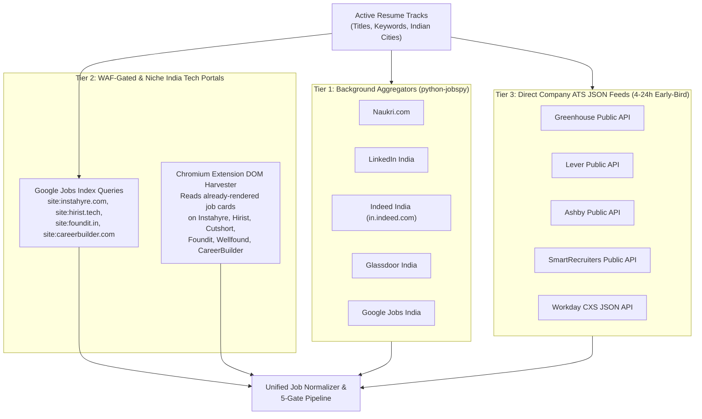

# 01. Platform Landscape & Job Collection Strategy (India-First)

Job discovery is divided into **three collection tiers** so that every major Indian board, global aggregator, niche tech portal, and direct company career page is covered reliably at **\$0 cost** without tripping anti-bot bans.

---

## 1. Three-Tier Job Source Architecture

---

## 2. Detailed Breakdown by Tier

### Tier 1: Core India & Global Aggregators (`python-jobspy`)
`python-jobspy` runs locally on your residential IP and queries multiple boards concurrently in Python:

| Platform | Collection Mechanism | Technical Reality & Rate-Limit Mitigations |
| :--- | :--- | :--- |
| **Naukri.com** | `python-jobspy` (`naukri`) + Chromium Extension capture | Highest India tech recruiter volume. Extension also captures logged-in metadata (recruiter activity, exact skills, experience bands). |
| **LinkedIn India** | `python-jobspy` (`linkedin`) + Chromium Extension capture | Public guest search works without login; aggressive polling for full JDs triggers HTTP `429`. Run throttled background pulls (`~1 req / 3–5s`) with incremental `hours_old` windows. |
| **Indeed India** | `python-jobspy` (`indeed`, `country_indeed='india'`) | Uses GraphQL/mobile endpoints; highly reliable with minimal rate-limiting and returns full JDs + direct apply URLs. |
| **Glassdoor India** | `python-jobspy` (`glassdoor`) | Uses CSRF + GraphQL; stricter than Indeed, works cleanly on residential IP with moderate batch sizes (`20–50` jobs/run). |
| **Google Jobs India** | `python-jobspy` (`google`) | Acts as a free meta-aggregator indexing postings across Foundit, CareerBuilder, Wellfound, BuiltIn, and company portals. |

---

### Tier 2: High-Signal India Tech Portals & Legacy Global Boards
Portals such as **Instahyre**, **Hirist.tech**, **Cutshort**, **Wellfound (AngelList)**, **Foundit.in** (formerly Monster India/APAC), **Monster**, and **CareerBuilder** have deprecated general public RSS feeds and aggressively gate headless requests behind Cloudflare/Akamai WAFs or login walls.

Instead of fighting fragile headless scrapers, Tier 2 uses a **two-pronged unbreakable approach**:
1. **Google Jobs Index Queries:** Run `python-jobspy` (`google` engine) targeting indexed listings via `site:instahyre.com`, `site:hirist.tech`, `site:foundit.in`, and `site:careerbuilder.com`.
2. **In-Browser Extension DOM Harvester:** Whenever you browse a logged-in search page on Instahyre, Hirist, Cutshort, Foundit, Wellfound, or CareerBuilder in Chrome/Edge/Brave, the extension's content script reads the already-rendered job cards directly from the live DOM and syncs them to `http://localhost:8000` with 1 click (zero WAF triggers, zero CAPTCHA evasion needed).

---

### Tier 3: Direct Tech Company ATS Portals ("Early-Bird Advantage")
Most Indian tech startups, unicorns, and global GCCs host their career pages on 5 standard ATS platforms that serve **unauthenticated public JSON**. Polling these directly catches roles **4–24 hours before** they appear on LinkedIn or Naukri, and never gets IP-blocked:

| ATS Platform | Public Unauthenticated Endpoint & Parameters | Technical Notes & Known Quirks |
| :--- | :--- | :--- |
| **Greenhouse** | `GET https://boards-api.greenhouse.io/v1/boards/{board_token}/jobs?content=true` *(Single job: `/v1/boards/{board_token}/jobs/{job_id}`)* | Keyless, returns full HTML JD, offices, departments, and direct apply link. *(Note: Greenhouse's POST application API requires a company API key, so applications are submitted via browser autofill.)* |
| **Lever** | `GET https://api.lever.co/v0/postings/{company}?mode=json` *(Single job: `/v0/postings/{company}/{posting_id}`)* | Keyless, supports `skip`/`limit` pagination and returns structured description blocks, categories, and apply URLs. |
| **Ashby** | `GET https://api.ashbyhq.com/posting-api/job-board/{company_token}?includeCompensation=true` | Public job-board endpoint requires no auth and returns structured job listings and compensation metadata. |
| **SmartRecruiters** | `GET https://api.smartrecruiters.com/v1/companies/{companyIdentifier}/postings` *(Single job: `/postings/{postingId}`)* | Keyless public Posting API supporting `q`, `limit`, `offset`, `country`, and `department` filters. |
| **Workday (CXS)** | `POST https://{tenant}.wd{n}.myworkdayjobs.com/wday/cxs/{tenant}/{site}/jobs` Body: `{"appliedFacets":{},"limit":20,"offset":0,"searchText":""}` *(Details: `GET .../wday/cxs/{tenant}/{site}{externalPath}`)* | **Quirks to enforce in code:** 1. `limit` cannot exceed **20** (21+ returns HTTP 400). 2. Queries cap at **2,000 jobs total** (segment via `appliedFacets` by India location if needed). 3. Requesting `offset` past total loops back to page 1—always stop using initial `total`. 4. `{tenant}` path segment is case-sensitive. |

#### India Location Filtering on ATS Feeds
Direct ATS endpoints return global roles unless filtered. The local collector filters postings for India hubs:
`Bengaluru / Bangalore`, `Hyderabad`, `Pune`, `Gurugram / Gurgaon`, `Noida`, `Delhi NCR`, `Chennai`, `Mumbai`, and `Remote - India`.

---

## 3. Pre-Seeded India Watchlist & 1-Click Discovery

* **Pre-Seeded Registry:** Ships with an editable local JSON/SQLite registry of ATS board tokens (`Greenhouse`, `Lever`, `Ashby`, `Workday`, `SmartRecruiters`) for major Indian product companies, unicorns, and Global Capability Centers (GCCs)—e.g., *Razorpay, Cred, Postman, PhonePe, Swiggy, Groww, Meesho, BrowserStack, Freshworks, Chargebee, Stripe, Uber, Atlassian, Rubrik, Rippling, Confluent, Salesforce, Nvidia, Walmart Global Tech, Cisco, Adobe, Mastercard*.
* **1-Click "+ Watch Company ATS" Button:** Whenever you visit *any* company's Greenhouse, Lever, Ashby, Workday, or SmartRecruiters career site in Chromium, the extension detects the ATS URL pattern and offers a **"+ Watch Company ATS"** button to add that company to your local polling watchlist permanently.

---

## 4. Operational Resilience & Auto-Maintenance

1. **Fault-Isolated Collector Workers:** Each board and ATS connector runs in its own isolated try/except task with configurable delays. If LinkedIn temporarily throttles (`429`) or a portal changes HTML layout, all other collectors continue working uninterrupted.
2. **Source Health Status Badges:** The dashboard displays per-source telemetry (`🟢 OK`, `🟡 Throttled / Rate-Limited`, `🔴 Selector / Fetch Error`) with timestamps of the last successful sync.
3. **Unbreakable Browser Fallback:** Even if a board blocks background scraping completely, opening the site in your Chromium browser allows the extension's DOM Harvester to capture listings directly into your local database.
4. **Auto-Pruning Expired / Closed Jobs:**
   - **ATS Sync Pruning:** When a company's live ATS JSON feed refreshes and a previously stored `job_id` disappears, it is automatically marked **`Closed`** and removed from your active To-Apply queue.
   - **Browser Closed-Page Detection:** If you open a Naukri/LinkedIn/Indeed tab that displays *"Job expired"* or *"No longer accepting applications"*, the extension detects it and marks the record **`Closed`** automatically.
