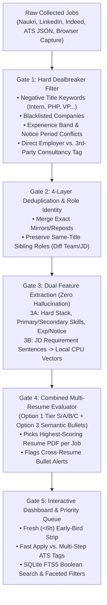
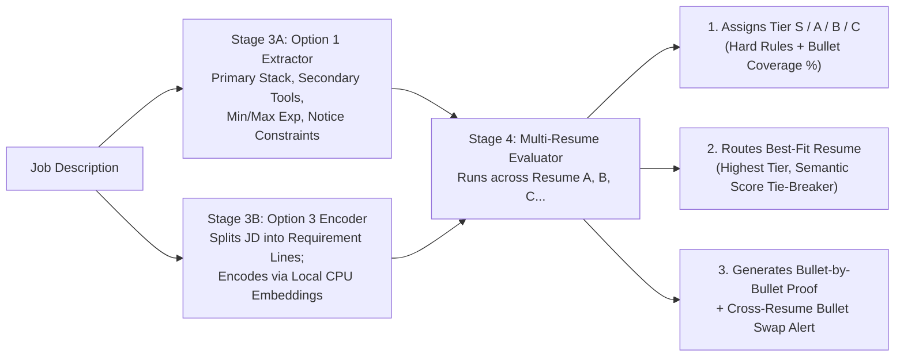

# 02. Multi-Resume Handling, Search, Filtering & Combined Scoring

Supporting **multiple resumes** cleanly means keeping your factual career biography 100% consistent across all applications while routing each job to the strongest resume variant and filtering out irrelevant noise.

---

## 1. Two-Layer Multi-Resume Architecture

```
┌─────────────────────────────────────────────────────────────────────────┐
│ LAYER 1: SHARED VERIFIED FACT VAULT (Immutable Across All Resumes)      │
│ • Personal Info, Contact Links (LinkedIn, GitHub, Portfolio)            │
│ • Official Employment History (Companies, Exact Dates, Designations)    │
│ • Indian Education (10th, 12th, UG/PG CGPA & %, Active Backlogs)        │
│ • Current/Expected CTC (LPA/INR), Notice Period, Exact LWD              │
│ • Master Per-Skill Experience Ledger (e.g., Python: 4 yrs, React: 2.5)  │
└───────────────────────────────────┬─────────────────────────────────────┘
                                    │ Shares grounded facts
        ┌───────────────────────────┼───────────────────────────┐
        ▼                           ▼                           ▼
┌───────────────────┐     ┌───────────────────┐     ┌───────────────────┐
│ Resume A (PDF)    │     │ Resume B (PDF)    │     │ Resume C (PDF)    │
│ "Backend Track"   │     │ "Full-Stack Track"│     │ "AI/Data Track"   │
│ • Target Titles   │     │ • Target Titles   │     │ • Target Titles   │
│ • Track Skills    │     │ • Track Skills    │     │ • Track Skills    │
│ • Bullets Vectors │     │ • Bullets Vectors │     │ • Bullets Vectors │
│ • Cover Template  │     │ • Cover Template  │     │ • Cover Template  │
└───────────────────┘     └───────────────────┘     └───────────────────┘
```

* **Layer 1 (Shared Fact Vault):** Prevents contradictory data (like different employment dates or CTC numbers) across applications.
* **Layer 2 (Multi-Resume Registry):** Stores each uploaded PDF variant alongside its **Track Name**, **Target Role Titles / Search Keywords**, **Skills Present on That Specific Resume**, pre-encoded **Bullet Embeddings**, and a **Track-Specific Pre-Approved Summary Template**.

---

## 2. Upstream Search Generation

Instead of running one generic search, the collector builds targeted search queries from your **active Resume Tracks**:
* *Example (Backend Track):* `("Backend Engineer" OR "Python Developer" OR "SDE 2") AND location IN (Bengaluru, Hyderabad, Pune, Gurugram, Remote)`
* *Example (Full-Stack Track):* `("Full Stack Engineer" OR "React Node Developer") AND location IN (...)`
* Queries run incrementally using `hours_old` filters (e.g., last 24h or 72h) after initial sync.

---

## 3. The 5-Gate Local Filtering & Ranking Pipeline



### Gate 1: Hard Dealbreakers & Consultancy Detection
* **Negative Title Keywords:** Drops mismatched domains/levels (e.g., `Intern`, `Director`, `VP`, `PHP`, `WordPress`, `Salesforce`, `SAP`, `Manual Testing`).
* **Company Blacklist:** Automatically hides current/past employers or unwanted organizations.
* **Experience Band Parser:** Extracts patterns like `"4-7 years"`, `"minimum 5 years"`, `"2+ yrs"` and compares against your Fact Vault's verified `Total Experience`.
* **Notice Period Conflict Detector:** Flags JDs containing `"Immediate joiner only"` or `"Max 15 days notice"` if your Fact Vault notice period exceeds the limit.
* **Direct Employer vs. Staffing Consultancy Classifier:** Tags each job as **`Direct Product / Tech Company`**, **`Direct Service / IT Consulting`**, or **`Third-Party Staffing Agency`** (catching anonymous agency listings like *"Hiring for a Leading Product MNC"*), letting you prioritize direct employers.

---

## 4. Gate 3 & Gate 4: Scoring Alternatives Researched

Five deterministic, \$0 scoring models were evaluated during Stage 1 before selecting our combined architecture:

| Scoring Option | Mechanism | Speed (100 Jobs) | Offline & \$0? | Hallucination Risk | Core Strength & Limitation |
| :--- | :--- | :--- | :--- | :--- | :--- |
| **Option 1: Tiered Boolean Checklist (`S/A/B/C`)** | Classifies jobs into strict knock-out tiers using Primary Stack, Secondary Stack, Archetype, and Experience/Notice checks. | `< 0.1s` | Yes | **0%** | Eliminates false high percentages on incompatible stacks; lacks fine ranking *within* the same tier. |
| **Option 2: Real ATS Search Simulator (`BM25 + Zones`)** | Simulates Naukri/Workday search ranking with Okapi BM25 weighted by resume zone (`3x` Headline/Recent, `2x` Bullets, `1x` Skills list). | `< 0.2s` | Yes | **0%** | Great for estimating ATS keyword rank; misses semantic synonyms phrased differently. |
| **Option 3: Local Semantic Bullet Alignment** | Uses a ~90 MB local CPU embedding model (`bge-small-en-v1.5` / `all-MiniLM-L6-v2`) to match JD requirement lines to your real resume bullets. | `~ 1.5–2s` (CPU) | Yes | **0%** | Captures meaning beyond exact keywords with bullet-level proof; alone, can score conceptually similar but wrong-language stacks too high. |
| **Option 4: Skill-Depth & Recency Matrix** | Scores whether your verified years per skill meet JD floors, applying recency decay (`1.0x` current role vs `0.5x` older roles). | `< 0.1s` | Yes | **0%** | Great for Naukri "relevant years in Skill X" cutoffs; requires detailed skill-date mapping. |
| **Option 5: Pareto Multi-Axis Scorecard** | Displays 4 unblended bars (Must-Have Coverage, Exp Fit, ATS Density, Logistics Fit) instead of a single score. | `< 0.1s` | Yes | **0%** | Maximum transparency; needs a primary sort order for fast daily queues. |

---

## 5. Selected Engine: Combined Option 1 + Option 3 Architecture

Combining **Option 1 (Tiered Checklist)** with **Option 3 (Local Semantic Bullet Alignment)** pairs hard stack/logistics guardrails with deep, zero-hallucination semantic proof:



### A. Combined Tier Definitions (`Tier S / A / B / C`)

| Tier | Option 1 Hard Checklist Rules | Option 3 Semantic Bullet Coverage (`sim >= 0.72`) | Queue Behavior |
| :--- | :--- | :--- | :--- |
| **Tier S** *(Apply First)* | Core Role Archetype matches track • **100% Primary Stack** present • Experience, Location & Notice compatible | **$\ge 80\%$** of JD requirement lines map to a real bullet on this resume | Pinned to top priority queue (especially if `< 6h` old) |
| **Tier A** *(Strong Fit)* | **100% Primary Stack** present • Experience compatible ($\pm 1$ yr) • Missing $\le 1–2$ secondary tools | **$60\%–79\%$** of JD requirement lines map to a real bullet | Main daily apply queue |
| **Tier B** *(Stretch Fit)* | Missing 1 primary framework (e.g., Django vs FastAPI) **OR** 1–2 yrs below experience floor | **$40\%–59\%$** semantic bullet coverage | Selective / secondary queue |
| **Tier C** *(Low Fit)* | Missing core programming language **OR** hard experience/location conflict | **$< 40\%$** semantic bullet coverage | Auto-collapsed out of daily queue |

### B. Best-Resume Selection & Cross-Resume Bullet Alert
1. **Best-Resume Routing:** Each job is evaluated against every resume in your registry. The resume achieving the highest Tier (`S > A > B > C`) wins; ties within the same Tier are broken by Option 3's **Semantic Bullet Coverage %**. The Chromium extension automatically pre-selects that winning PDF for upload.
2. **Bullet-by-Bullet Proof Table (Zero Hallucination):** Inside any job card, you see every JD requirement sentence paired directly with the highest-matching **real bullet** from your resume (or explicitly flagged `Gap`).
3. **Cross-Resume Bullet Alert:** If an unmatched requirement on your winning resume (`Resume A`) is already proven by a real bullet on another resume (`Resume B`), the UI displays a prompt highlighting that exact verified bullet from `Resume B`.

* **Performance:** Your resume bullets are embedded **once** upon upload. Evaluating 100 newly scraped jobs takes **~2 seconds** on a standard CPU (`~15–25ms/job`), offline and at **\$0 cost**.

---

## 6. Gate 5: Dashboard Filters, Early-Bird Priority & Apply Friction Tags

* **⚡ Fresh (`< 6h`) Priority Strip:** Pins `Tier S` and `Tier A` openings posted in the last 6 hours to the very top so you apply within the first 50–100 applicants.
* **Apply Friction Tags:**
  * **⚡ Fast Apply:** Naukri Apply / Chatbot, LinkedIn Easy Apply, Instahyre 1-Click, Greenhouse / Lever / Ashby single-page forms.
  * **🏢 Multi-Step Enterprise ATS:** Workday, SmartRecruiters, Taleo, SuccessFactors.
* **Quick Facets:** Filter by **Resume Track**, **Tier (`S/A/B`)**, **`Missing <= 1 Skill`**, **City**, **Notice Period Compatibility**, and **Direct Employer Only**.
* **Offline Full-Text Search (SQLite FTS5):** Instant boolean queries across all stored JDs (e.g., `FastAPI AND (Kafka OR RabbitMQ) NOT "night shift"`).
