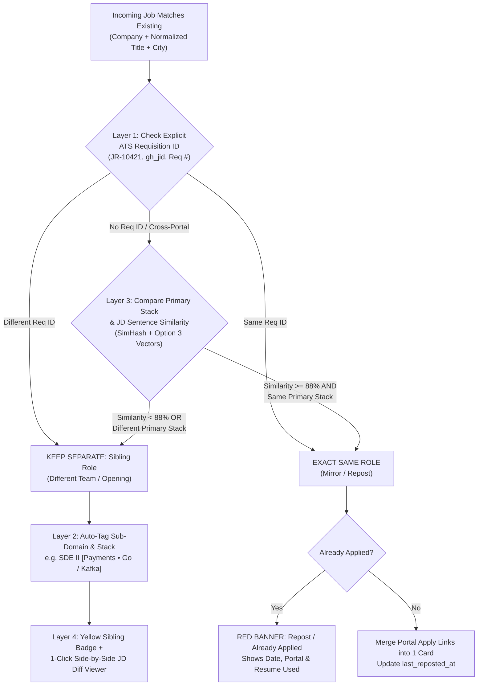

# 03. Role Identity, Deduplication & "Already Applied" Tracking

Two critical real-world pitfalls can break a job automation system:
1. **Missing Sibling Roles (Over-Merging):** A company like *Razorpay*, *Swiggy*, or *Walmart Global Tech* opens **multiple roles with the exact same title** (e.g., `"SDE II"` in `"Bengaluru"`) for completely different teams (*Payments Backend* vs. *Consumer React* vs. *Data Platform*). Merging purely by `(Company + Title + City)` hides valid openings.
2. **Reposts & Forgotten Applications (Under-Tracking):** Portals repost the exact same JD under a new `job_id` every 7–14 days, or you apply via mobile/another portal and forget.

---

## 1. The 4-Layer Role Identity Fingerprint

Every incoming job with the same `(Company + Normalized Title + City)` as an existing or applied record runs through this deterministic decision tree:

### How the 4 Layers Work Together
1. **Layer 1 — Requisition ID Isolation:** Extracts ATS IDs (`JR10421`, `Req #88219`, `gh_jid=...`) from URLs and JD text. Distinct Req IDs are **never** merged.
2. **Layer 2 — Auto-Generated Role Differentiator Sub-Tag:** Appends a deterministic sub-domain/stack label in the UI so identical titles are immediately distinguishable:
   - `Razorpay — SDE II [Payments • Go / Kafka / PostgreSQL]`
   - `Razorpay — SDE II [Frontend Platform • React / TypeScript]`
   - `Razorpay — SDE II [Data Eng • Python / Spark / Airflow]`
3. **Layer 3 — JD Content Similarity Threshold (`88%`):** Compares normalized requirement sentences and extracted primary stack across portals (e.g., Naukri vs. LinkedIn). Below `88%` similarity—or if the core tech stack differs—the job remains a separate **Sibling Role**.
4. **Layer 4 — 1-Click Side-by-Side JD Diff Viewer:** On any Sibling Role, clicking **[View JD Diff]** displays the previously applied JD next to the new JD, highlighting added/changed requirement lines in green so you verify in seconds that it is a genuinely distinct opening.

### Ghost Jobs & Repost Detection
* Every role tracks both **`first_seen_at`** and **`last_reposted_at`** using `(company_slug + normalized_title + description_hash)`.
* If a company deletes and re-uploads the identical JD 14 days later as *"Posted 2 hours ago"*, it surfaces as a **Repost** (and if you already applied, blocks accidental double-submission).

---

## 2. 4-Way Automatic "Already Applied" Capture

Relying on manual `"Mark Applied"` clicks causes missed records. The system captures application status through **4 overlapping mechanisms**:

1. **Extension Submit-Click & Confirmation-Screen Detector:**
   - Watches for the final Submit/Apply button click **and** post-submit DOM confirmations (Naukri *"Successfully applied"* banner, LinkedIn *"Application sent"* modal, Greenhouse `/confirmation`, Workday *"Thank you for applying"* screen).
2. **Native Portal "Already Applied" DOM Badge Sync:**
   - Whenever you view a job page or *"Applied Jobs"* history tab on Naukri, LinkedIn, Indeed, Instahyre, or Workday (even if you originally applied from your phone), the extension reads the site's native `"Applied on..."` badge and syncs the status + JD snapshot into your local SQLite database.
3. **Two-Timestamp `"In-Progress / Draft"` vs. `"Confirmed Submitted"` Tracking:**
   - Records `autofill_started_at` separately from `submitted_at`. If you open a Workday tab, autofill half of it, get interrupted, and close Chrome, it moves to your **"Unfinished / Abandoned Applications"** filter instead of falsely marking as Applied.
4. **Instant 4-State Status Banner (In Dashboard & Extension):**

| Status Banner | Condition & Meaning |
| :--- | :--- |
| 🟢 **NEW ROLE — NOT APPLIED** | Never applied to this role or a same-title sibling at this company. |
| 🟡 **NEW SIBLING ROLE (SAME TITLE, DIFFERENT JD)** | Applied to a same-title opening at this company previously, **but the JD/stack differs**. Safe to review with **[Compare JDs]**. |
| 🔵 **STARTED BUT NOT SUBMITTED** | You opened or autofilled this form earlier, but no final submission was confirmed. |
| 🔴 **ALREADY APPLIED (EXACT / REPOST)** | Exact match or repost of an already-submitted role; displays **Date Applied**, **Portal Used**, and **Exact Resume PDF Used**. |

---

## 3. Permanent Offline Snapshots, Mini-CRM & Company Cooldowns

### A. Permanent Offline Application Snapshot (For Unexpected HR Calls)
The moment a job is marked `Applied`, SQLite saves an immutable **Application Snapshot**:
* Full offline copy of the Job Description text (survives even after the company deletes the posting).
* Exact Resume variant submitted (`Resume_A_Backend.pdf` vs. `Resume_B_FullStack.pdf`).
* Exact form values entered in that submission (Current CTC, Expected CTC, Notice Period, custom answers).
* Enables `< 1 second` search by company name when a recruiter calls weeks later so your numbers and resume details match 100%.

### B. Post-Application Interview Mini-CRM
Clean status pipeline for tracking callbacks, recruiter contacts, coding tests, and interview notes:
`Discovered` → `Shortlisted` → `In Progress (Draft)` → `Applied` → `OA / Coding Test` → `Recruiter Screen` → `Tech Interviews` → `Offer` / `Rejected` / `No Response (30d)`.

### C. Company-Level Application Cooldown Badge
Inside ATS platforms (Greenhouse, Lever, Workday), recruiters view all your prior applications to that company on one candidate profile, and many companies enforce a **2–3 applications per 30–90 days** limit. Both the dashboard and extension show a **Company Cooldown Badge** (e.g., *"ℹ️ 2 Active Applications at Razorpay in Last 30 Days"*), preventing accidental ATS spam flags.
