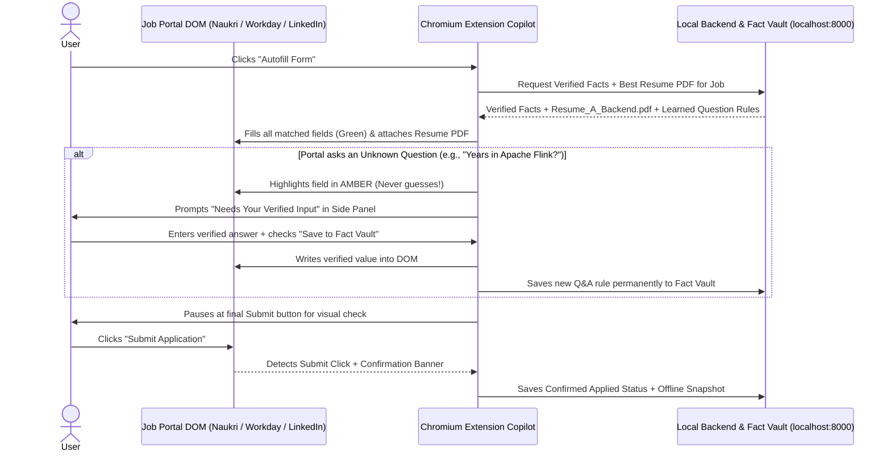

# 04. Zero-Hallucination Autofill & Chromium Side-Panel Copilot

---

## 1. Why Headless "Auto-Apply Bots" Fail vs. Chromium Copilot

Pure unattended Selenium/Playwright auto-apply bots fail in real-world Indian job hunting for three reasons:
1. **Account Bans & Fingerprinting:** LinkedIn, Naukri, and Indeed actively detect headless automation telemetry and restrict or permanently ban accounts.
2. **CAPTCHA, Cloudflare Turnstile & 2FA Gates:** Enterprise portals (Workday, Indeed, Foundit) enforce anti-bot and email OTP gates that cannot and must not be bypassed programmatically.
3. **Disqualifying Unreviewed Answers:** Guessing answers to screening questions (*Notice period, CTC, Visa status, Relocation*) leads to automatic rejection or background verification (BGV) mismatches.

**Solution:** A **Manifest V3 Chromium Side-Panel Extension (`chrome.sidePanel`)** running inside your normal, logged-in Chrome/Brave/Edge browser. Using the native Chromium Side Panel avoids CSS and Content Security Policy (CSP) collisions with Workday and Naukri's right-hand chatbot drawer—and **always pauses at the final Submit button** for human verification.

---

## 2. Four Principles of Zero-Hallucination Autofill

### Principle 1: The Verified Fact Vault (100% Deterministic)
* No generative AI is ever used to fill factual fields.
* Names, dates, company titles, academic percentages/CGPA, CTC, notice period, and yes/no rules are resolved strictly via deterministic key matching and explicit aliases.

#### India-Specific Verified Fact Vault Schema (BGV-Consistent)

| Category | Fields Stored in Fact Vault |
| :--- | :--- |
| **Compensation (INR / LPA)** | Current Total CTC (in LPA and exact INR), Fixed CTC vs. Variable/Bonus split, Expected CTC (LPA, exact INR, or minimum acceptable % hike). |
| **Notice Period & Availability** | Official Notice Period (`Immediate`, `15 Days`, `30 Days`, `60 Days`, `90 Days`), Currently Serving Notice (`Yes/No`), Exact Last Working Day (`LWD`), Notice Negotiable / Buyout Available (`Yes/No` + minimum days). |
| **Experience Matrix** | Total Experience (`Years + Months`), Relevant Experience (`Years + Months`), Per-Skill Experience Ledger (`Python: 3.5 yrs`, `React: 2.0 yrs`, `AWS: 2.0 yrs`, etc.). |
| **Location & Work Mode** | Current City, Hometown, Preferred Cities (auto-maps city aliases: `Bangalore` ↔ `Bengaluru`, `Gurgaon` ↔ `Gurugram`, `Delhi NCR` ↔ `Noida/Gurugram/Delhi`), Willing to Relocate, Open to Hybrid / On-site / Rotational Shifts. |
| **Indian Education Format** | 10th (SSC) & 12th (HSC/Diploma) % / CGPA + Board + Passing Year; UG / PG Degree (`B.Tech/B.E.`, `BCA`, `M.Tech`, `MCA`), Specialization, University, 10-point CGPA **and** equivalent %, Active Backlogs (`0`). |

---

### Principle 2: "Unknown Fact = Pause, Highlight & Learn"

---

### Principle 3: Pre-Approved Templates Only for Open-Ended Text
* Free-text fields (*"Cover Note"*, *"Why do you want to work here?"*) use **user-authored, locked templates** tied to each Resume Track, substituting only verified placeholders such as `{{company}}`, `{{role_title}}`, and `{{matched_top_3_skills}}`.

### Principle 4: Strict PII Guardrails
* Sensitive Indian government/identity fields—**PAN Card Number, Aadhaar Number, Passport Number, and Full Date of Birth**—are explicitly blocked from automatic filling. If a portal requests them during initial application, the extension flags the field with a security prompt so you decide manually.

---

## 3. Chromium Extension DOM Engineering & Portal Coverage

### A. 3-Tier Field Matching Strategy
To stay resilient against minor portal UI updates:
1. **Tier 1 — Platform-Specific Adapters:** Dedicated selectors for **Naukri** (including the right-hand **Apply Chatbot / Questionnaire drawer**), **LinkedIn Easy Apply**, **Indeed India**, **Foundit.in**, **Instahyre**, **Hirist**, **Cutshort**, **Greenhouse**, **Lever**, **Ashby**, **Workday**, and **SmartRecruiters**.
2. **Tier 2 — Semantic HTML Heuristic Matcher:** Parses `<label for>`, `aria-label`, `placeholder`, `name`, and `autocomplete` attributes against normalized Fact Vault keys and learned Q&A rules.
3. **Tier 3 — User-Confirmed Rule Capture:** Any unmapped field falls back to the Amber Pause-and-Learn prompt and remembers the mapping for future forms.

### B. Technical DOM Mechanisms
* **React / Angular Controlled State Bypass:** Modern portals (Workday, Ashby, LinkedIn, Naukri Chatbot) ignore plain `element.value = x` assignments. The extension invokes native `HTMLInputElement.prototype` / `HTMLTextAreaElement.prototype` property setters paired with bubbling `input`, `change`, and `blur` events so framework state commits properly.
* **Automatic Resume PDF Injection (`DataTransfer` API):** Fetches the job's winning Resume PDF binary directly from `http://localhost:8000` and injects it into `<input type="file">` via browser `DataTransfer`, eliminating manual file-picker browsing across multiple resume PDFs.
* **Virtualized Custom Dropdowns:** Handles ARIA comboboxes and custom `
` dropdown lists (common in Workday and Greenhouse) by opening the menu, matching the option text deterministically, and dispatching click selection.
* **Multi-Entry Array Filling:** Populates repeating Work Experience and Education blocks sequentially on multi-step enterprise ATS forms (especially Workday).

---

## 4. Data Portability & 1-Click Local Backup

Because all state lives locally on your machine (`SQLite + uploaded PDFs`), the dashboard includes a **1-Click Export / Import** tool generating a portable archive of:
* Your Verified Fact Vault & Learned Question Rules
* Multi-Resume Registry & PDFs
* Company ATS Watchlist & Blacklists
* Full Application History & Offline JD Snapshots
