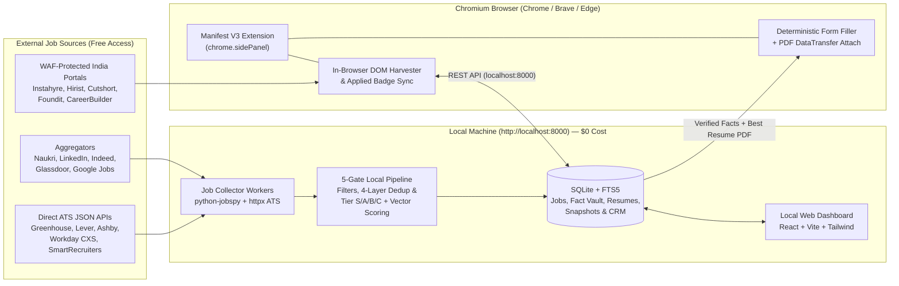

# Stage 1: Initial Research — Free India-First Job Automation & Application Copilot

> **Project Phase:** Stage 1 — Initial Deep Research (Complete)  
> **Target Environment:** Windows / Local-First Desktop Web App + Chromium Browser Extension (Chrome, Edge, Brave)  
> **Core Mandate:** **\$0 Forever** to build, host, and maintain • **India-First** • **Zero Hallucinations** • **Human-in-the-Loop Safety**

---

## 1. Executive Summary & Non-Negotiable Principles

This project is a local-first job discovery, intelligent multi-resume matching, and assisted application system tailored primarily for the **Indian tech job market** while supporting major global boards and direct tech company Applicant Tracking Systems (ATS).

1. **\$0 Total Cost of Ownership (Free Forever):**
   - Runs 100% locally on your own machine—no cloud hosting fees, no paid database servers, no paid scraper APIs (Apify/RapidAPI), and no paid LLM subscriptions.
   - The Chromium extension loads directly via Developer Mode (`chrome://extensions` → *Load unpacked*), avoiding the Chrome Web Store registration fee.
2. **Local-First Residential IP Advantage & Privacy:**
   - Running collectors on your residential connection avoids datacenter IP bans that break free cloud runners.
   - Your resume PDFs, salary (CTC), phone number, notice period, and portal login cookies never leave your machine.
3. **India-First Portal & Screening Support:**
   - Native support for Indian job boards (**Naukri, LinkedIn India, Indeed India, Glassdoor India, Foundit/Monster, Instahyre, Hirist, Cutshort, Wellfound, CareerBuilder**) and Indian Unicorn / Global GCC ATS career portals (**Greenhouse, Lever, Ashby, Workday, SmartRecruiters**).
   - Built-in India-specific application schema (LPA/INR CTC, Notice Period, Last Working Day, per-skill experience years, 10th/12th/UG/PG grades, and city aliases like `Bangalore` ↔ `Bengaluru`).
4. **Zero Hallucinations & Zero Incorrect Info:**
   - Generative LLMs are **excluded** from filling factual fields and scoring jobs.
   - All autofill values come strictly from a deterministic **Verified Fact Vault**. Unknown screening questions pause and ask you once rather than guessing.
   - Scoring combines deterministic hard rules (**Option 1: Tier S/A/B/C**) with offline, non-generative CPU vector embeddings (**Option 3: Bullet-to-Bullet Alignment**).
5. **Human-in-the-Loop Application (No Account Bans):**
   - Instead of headless background bots (which trigger anti-bot bans, Cloudflare/CAPTCHA blocks, and incorrect submissions), the **Chromium Side-Panel Extension** operates inside your real, logged-in browser session and always pauses before the final **Submit** click.
6. **Stage-Gated Development Workflow:**
   - **Stage 1:** Deep Research *(Current documentation)*
   - **Stage 2:** Architecture, Database Schema & Implementation Planning *(Requires explicit approval)*
   - **Stage 3+:** Incremental Code & Test Cycles *(Requires explicit approval)*

---

## 2. High-Level System Architecture

---

## 3. 100% Free-Forever Technology Stack

| Layer | Technology | Rationale |
| :--- | :--- | :--- |
| **Backend & Scheduler** | **Python 3.11+ & FastAPI + APScheduler** | Native runtime for `python-jobspy`, async ATS polling (`httpx`), PDF parsing (`pypdf`/`pdfplumber`), and lightweight REST APIs. |
| **Job Collection** | **`python-jobspy` + Custom ATS Connectors** | Pulls Naukri, LinkedIn, Indeed, Glassdoor, Google Jobs + direct unauthenticated JSON feeds for Greenhouse, Lever, Ashby, Workday, SmartRecruiters. |
| **Local Scoring Engine** | **Deterministic Rules + Local CPU Embeddings** (`sentence-transformers` / `onnxruntime` with `BAAI/bge-small-en-v1.5` or `all-MiniLM-L6-v2`) | ~90 MB offline model. Non-generative (0% hallucination risk), \$0 API cost, scores ~100 jobs in ~2 seconds on CPU. |
| **Database & Search** | **SQLite + SQLAlchemy/SQLModel + FTS5** | Zero-config single-file local database (`jobs.db`) with built-in Full-Text Search for instant offline boolean queries. |
| **Frontend Dashboard** | **React (Vite) + Tailwind CSS** | Fast local web UI for multi-resume triage, side-by-side JD diffing, Fact Vault editing, and application CRM tracking. |
| **Browser Copilot** | **Manifest V3 Chromium Extension (`chrome.sidePanel`)** | Sits cleanly alongside job portals without CSS/CSP clashes; handles DOM harvesting, React-safe autofill, PDF attachment, and submit tracking. |

---

## 4. Research Document Index

| Document | Contents Covered |
| :--- | :--- |
| [01_Platform_Landscape_and_Collection_Strategy.md](file:///f:/Projects/JobAutomation/Documentation/Innitial%20Research/01_Platform_Landscape_and_Collection_Strategy.md) | Tier 1–3 job sources, exact ATS public JSON endpoints (Greenhouse, Lever, Ashby, SmartRecruiters, Workday CXS), India watchlist, fault isolation, and auto-pruning. |
| [02_Multi_Resume_Search_Filtering_and_Scoring.md](file:///f:/Projects/JobAutomation/Documentation/Innitial%20Research/02_Multi_Resume_Search_Filtering_and_Scoring.md) | Two-layer multi-resume architecture, upstream query generation, 5-Gate pipeline, all 5 scoring alternatives, and the **Option 1 + Option 3 Combined Engine**. |
| [03_Role_Identity_Deduplication_and_Applied_Tracking.md](file:///f:/Projects/JobAutomation/Documentation/Innitial%20Research/03_Role_Identity_Deduplication_and_Applied_Tracking.md) | 4-Layer Role Identity Fingerprint (separating **Exact Reposts** from **Same-Title Sibling Roles**), Side-by-Side JD Diff Viewer, 4-Way Applied Capture, Offline Snapshots, and Company Cooldowns. |
| [04_Zero_Hallucination_Autofill_and_Chromium_Copilot.md](file:///f:/Projects/JobAutomation/Documentation/Innitial%20Research/04_Zero_Hallucination_Autofill_and_Chromium_Copilot.md) | Why headless bots fail, India-specific Verified Fact Vault schema, Pause-and-Learn unknown-question flow, PII guardrails, React state bypass, PDF `DataTransfer` upload, and backup portability. |
