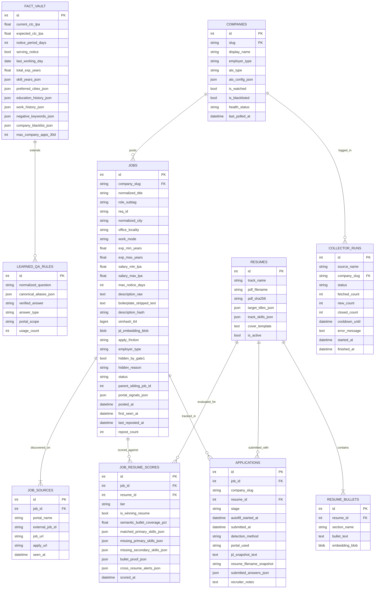

# 01. Database Schema, Local Security & REST API Contract

---

## 1. Entity-Relationship Diagram (SQLite + WAL + FTS5)

---

## 2. Table Specifications & Key Design Details

1. **`fact_vault` (Singleton Config Row):**
   - Stores all BGV-consistent India fields: `current_ctc_lpa`, `current_fixed_lpa`, `current_variable_lpa`, `expected_ctc_lpa`, `notice_period_days`, `serving_notice`, `last_working_day`, `notice_negotiable`, `min_negotiable_days`, `total_exp_years`, `relevant_exp_years`, `skill_years_json`, `current_city`, `hometown`, `preferred_cities_json`, `willing_to_relocate`, `work_modes_json`, `tenth_pct`, `twelfth_pct`, `education_history_json` (Degree, Specialization, University, 10-point CGPA + equivalent %, Active Backlogs), `work_history_json`, `negative_keywords_json`, `company_blacklist_json`, and `max_company_apps_30d`.
2. **`learned_qa_rules`:**
   - Captures every verified answer entered via the Extension's **Amber Pause-and-Learn** prompt so repeat questions across Naukri/LinkedIn/Workday/Greenhouse fill deterministically on future visits.
3. **`resumes` & `resume_bullets`:**
   - Stores immutable PDF file references (`data/resumes/<sha256>_<name>.pdf`), track search keywords, parsed skills, locked cover templates (`{{company}}`, `{{role_title}}`, `{{matched_top_3_skills}}`), and pre-encoded 384-dim `BAAI/bge-small-en-v1.5` float32 bullet vectors.
4. **`companies`:**
   - Powers both the **Pre-Seeded India ATS Watchlist** (`greenhouse | lever | ashby | workday | smartrecruiters`) and employer classification (`direct_product | direct_service | staffing_agency`).
5. **`jobs`, `job_sources` & `jobs_fts`:**
   - **Sibling Role Support:** Separate openings with the same `(company_slug + normalized_title + normalized_city)` but different `req_id` or `< 88%` boilerplate-stripped JD similarity remain distinct rows linked via `parent_sibling_job_id` and tagged with `role_subtag` (e.g., `"Payments • Go / Kafka"`).
   - **Portal Link Consolidation:** Multiple links pointing to the exact same role merge into `job_sources` (`naukri`, `linkedin`, `greenhouse`), with `repost_count` and `last_reposted_at` tracking ghost/reposted listings.
   - **No Silent Drops:** Jobs failing Gate 1 keep `hidden_by_gate1 = true` and `hidden_reason` so you can inspect and tune filters anytime.
   - **Offline Full-Text Search:** Virtual table `jobs_fts` (SQLite FTS5) indexes `title`, `company_name`, `role_subtag`, `boilerplate_stripped_text`, and `normalized_city`, kept synchronized automatically via `AFTER INSERT / UPDATE / DELETE` triggers.
6. **`job_resume_scores`:**
   - Stores per-resume `tier` (`S | A | B | C`), `is_winning_resume`, `semantic_bullet_coverage_pct`, matched/missing skill breakdowns, `bullet_proof_json` (each JD requirement line linked to the best matching real resume bullet + cosine similarity), and `cross_resume_alerts_json`.
7. **`applications`:**
   - Tracks two distinct timestamps (`autofill_started_at` for Drafts vs. `submitted_at` for Confirmed Submissions) and stores immutable offline interview snapshots (`jd_snapshot_text`, `resume_filename_snapshot`, `submitted_answers_json`).
8. **`collector_runs`:**
   - Records every run's status (`ok | throttled | error`) and `cooldown_until` timestamp for the automatic circuit breaker.

---

## 3. Localhost Security Hardening

Because the backend exposes personal CTC data, resumes, and application history over HTTP on your machine, strict local isolation prevents any untrusted website you visit from calling `http://127.0.0.1:8000`:

1. **Loopback-Only Bind:** Uvicorn binds strictly to `127.0.0.1:8000` (never `0.0.0.0`), making it unreachable from any external network device.
2. **Local Token Middleware (`X-Local-Token`):** On first startup, the backend generates a random 256-bit secret saved in `data/.local_token`. Every `/api/v1/*` request must include a valid `X-Local-Token` header.
   - The local React dashboard receives the token securely from the local origin served by FastAPI.
   - The Chromium extension stores the token once in `chrome.storage.local` during initial setup.
3. **Locked CORS Policy:** Only `http://127.0.0.1:8000` (local UI) and `chrome-extension://<extension_id>` are permitted. Arbitrary web origins are rejected.

---

## 4. Complete REST API Contract (`http://127.0.0.1:8000/api/v1`)

| Domain | Method & Path | Request / Query / Purpose |
| :--- | :--- | :--- |
| **Vault & Q&A** | `GET /vault` `PUT /vault` | Read or update the Verified Fact Vault, dealbreakers, templates, and blacklist. |
| | `GET /vault/qa-rules` `POST /vault/qa-rules` `DELETE /vault/qa-rules/{id}` | List, add (from Pause-and-Learn), or remove learned screening Q&A rules. |
| **Resumes** | `GET /resumes` `POST /resumes` `PATCH /resumes/{id}` `DELETE /resumes/{id}` | List tracks, upload PDF (`multipart/form-data`) + parse bullets + encode FastEmbed vectors, edit target titles/cover templates, or delete. |
| | `GET /resumes/{id}/file` `POST /resumes/{id}/reparse` | Stream raw PDF bytes to the extension's `DataTransfer` uploader; re-score existing active jobs after resume updates. |
| **Jobs & Diff** | `GET /jobs` | Faceted query params: `tier`, `resume_id`, `fresh_6h`, `missing_max`, `friction`, `employer_type`, `city`, `notice_compatible`, `include_hidden`, `fts_query`, `sort`, `limit`, `offset`. |
| | `GET /jobs/{id}` `PATCH /jobs/{id}/status` | Retrieve full job card, Option 1+3 bullet proof table, cross-resume alerts, and all portal links; manually close/unhide a job. |
| | `GET /jobs/{id}/diff/{sibling_id}` | Return line-by-line diff of boilerplate-stripped requirements between a Sibling Role and an existing/applied role. |
| **Collectors** | `POST /collectors/run` `GET /collectors/health` | Trigger manual sync (`source=all | ats | jobspy`); fetch per-source `OK / Cooldown / Error` badges and `cooldown_until` timers. |
| | `GET /watchlist` `POST /watchlist` `DELETE /watchlist/{slug}` | Manage watched Indian product companies/GCCs (`ats_type`, token/URL) — called by both Dashboard and **"+ Watch Company ATS"** extension button. |
| **Applications** | `GET /applications` `POST /applications` `PATCH /applications/{id}` | Query Mini-CRM (`stage=draft | applied | oa | screen | interview | offer | rejected`), create manual entry, update notes/stage. |
| | `GET /applications/cooldown/{company_slug}` | Return count and details of active applications to `company_slug` in the last `30` days vs. configured threshold. |
| **Extension Bridge** | `POST /extension/check-page` | Input `{url, external_job_id, company_name, title, jd_text, req_id}`. Returns **4-State Status Banner**, winning `resume_id` + filename, Company Cooldown warning, Fact Vault + Learned Q&A payload, and rendered Cover Template. |
| | `POST /extension/harvest` | Ingest array of DOM-extracted job cards from Instahyre, Hirist, Cutshort, Foundit, Naukri, LinkedIn, or CareerBuilder through Gates 1–4. |
| | `POST /extension/events` | Record lifecycle events: `autofill_started`, `submitted` (with `submitted_answers_json`), `native_applied_badge`, or `job_expired`. |
| **Backup** | `GET /backup/export` `POST /backup/import` | Download or restore a portable ZIP archive (`jobs.db` snapshot + `fact_vault.json` + `resumes/*.pdf`). |
