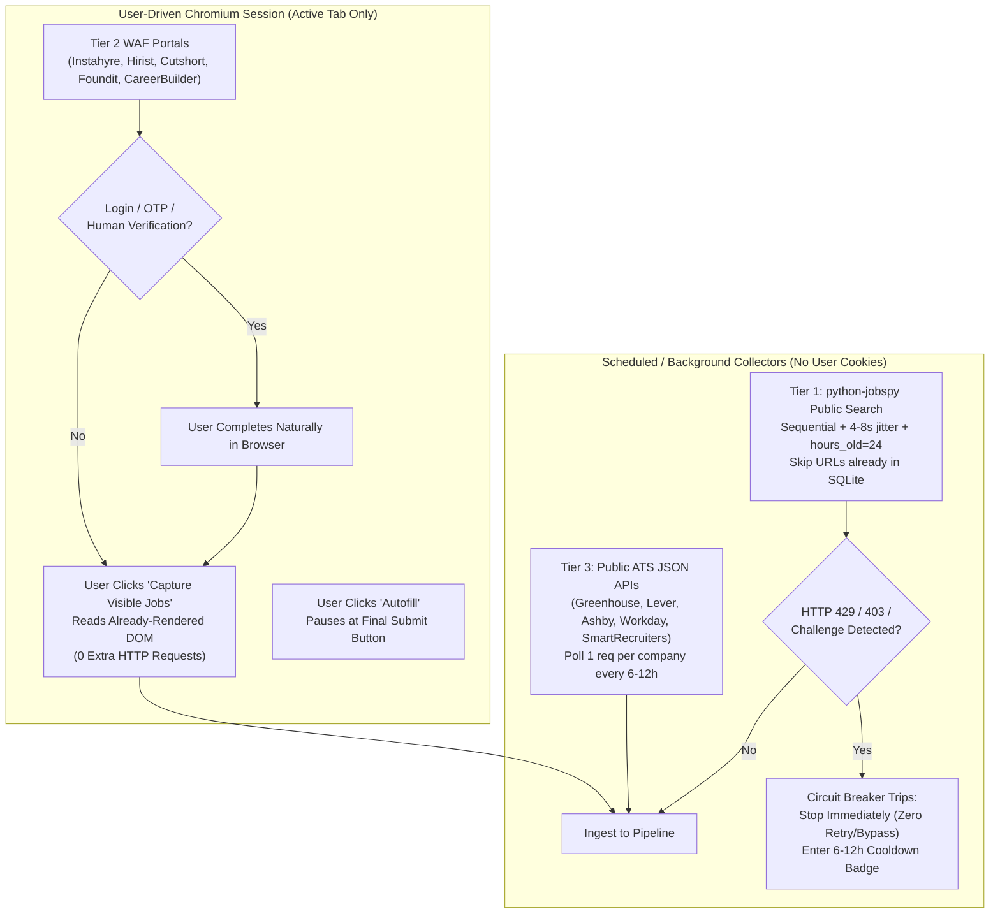
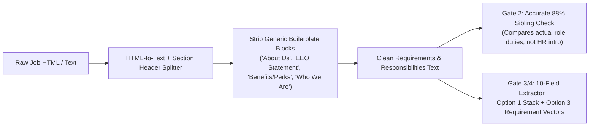

# 02. Safety, Anti-Flagging, High-Recall Search & Signal Extraction

This document defines the safeguards that keep your accounts and home IP safe, prevent silent missed jobs, and extract clean structured signal instead of generic HR boilerplate.

---

## 1. Anti-Ban, Anti-IP-Flagging & Non-Bypass Safety Architecture

### Five Hard Operational Rules
1. **Complete Credential Isolation:** Background Python collectors **never** store, import, or attach your LinkedIn, Naukri, Indeed, or Foundit session cookies or passwords. They query unauthenticated public endpoints only, ensuring your personal accounts cannot be suspended by background tasks.
2. **Polite Residential Rate Limits:**
   - **Direct ATS:** 1 lightweight JSON request per watched company every **6–12 hours** (with Workday strictly adhering to `limit <= 20`, segmenting >2,000 results via India `appliedFacets`, and stopping at the returned `total`).
   - **`python-jobspy`:** Sequential pulls with **4–8 second randomized jitter**, `hours_old=24` incremental windows, and `20–30` results per query. Any `job_url` or `external_job_id` already present in `job_sources` is skipped without re-fetching its detail page.
3. **Automatic Circuit Breaker (Zero Retries/Evasion):** If any board returns `HTTP 429`, `HTTP 403`, or a challenge page, that connector halts immediately, sets `cooldown_until` (`+6h to +12h`), and surfaces `🟡 Cooldown` in the dashboard while other collectors keep running.
4. **Zero Headless Scraping on Strict-WAF Portals:** For Instahyre, Hirist, Cutshort, Foundit, and CareerBuilder, zero Selenium/Playwright bots are used. You browse normally in Chromium and click **"Capture Visible Jobs"** to parse already-rendered DOM cards (0 extra server hits).
5. **Strict Non-Bypass Compliance:** We never attempt to bypass or solve CAPTCHAs, Cloudflare Turnstile, or 2FA gates; the extension remains passive until you complete verification in your visible browser.

---

## 2. Ensuring High-Recall Search Accuracy (Zero Silent Misses)

1. **Title Synonym Expansion + Title-Agnostic Direct ATS Scanning:**
   - Aggregator queries expand across Indian role equivalents per Resume Track (e.g., `"Backend Engineer"`, `"SDE 2"`, `"SDE-II"`, `"Software Engineer Backend"`, `"Python Developer"`).
   - **Direct ATS feeds** fetch **all open India postings** at watched companies regardless of title, scoring them via Option 1 + Option 3 directly on skills and responsibilities—catching non-standard titles like `"Member of Technical Staff"` or `"Product Engineer"`.
2. **Deterministic Indian City & Hub Normalizer:**
   - Maps regional variations before filtering:
     - `Bengaluru` ↔ `Bangalore`, `BLR`, `Karnataka`
     - `Delhi NCR` ↔ `Gurugram`, `Gurgaon`, `Noida`, `New Delhi`, `Faridabad`
     - `Hyderabad` ↔ `Hyd`, `Secunderabad`
     - `Mumbai` ↔ `Navi Mumbai`, `Thane`
     - `Remote - India` ↔ `WFH`, `Work From Home (India)`
3. **Hidden / Filtered Audit Trail (Zero Silent Drops):**
   - Gate 1 never deletes filtered jobs. Rejected records remain stored with `hidden_by_gate1 = true` and an explicit `hidden_reason` (e.g., `"Title matched negative keyword: 'Intern'"`, `"JD min exp 8 yrs > your 3.5 yrs"`, `"Classified as Third-Party Staffing Agency"`), inspectable via a dedicated dashboard audit tab.

---

## 3. Boilerplate Stripping & 10-Field High-Signal Extraction

Generic company boilerplate (*"About Company"*, *"Equal Opportunity Employer"*, *"Our Culture & Perks"*) ruins both **Gate 2 Sibling Similarity (88%)** and **Gate 3/4 Semantic Scoring** if left inside the text. **Gate 3 strips boilerplate first**, before computing `simhash_64`, `jd_embedding_blob`, or bullet matches:

### The 10 High-Signal Extracted Fields

| # | Extracted Field | Deterministic Extraction Method |
| :-: | :--- | :--- |
| **1** | **Boilerplate-Stripped Requirements** | Splits JD by section headings; discards company intro, benefits, and EEO footers so vectors and diffs reflect real job scope only. |
| **2** | **Must-Have vs. Good-to-Have Skills** | Parses skill tokens under mandatory headings (*"Required"*, *"Qualifications"*, *"What you'll need"*) separately from bonus headings (*"Nice to have"*, *"Preferred"*), mapped through a 500+ canonical skill taxonomy (`K8s` → `Kubernetes`, `ReactJS` → `React`). |
| **3** | **Experience Band (`min`–`max` yrs)** | Prefers structured portal metadata (`Naukri`/`Workday`), falling back to regex ranges (`"3-6 years"`, `"minimum 4 yrs"`, `"5+ years"`). |
| **4** | **Disclosed Compensation (LPA / INR)** | Captures structured ranges from Ashby (`includeCompensation=true`), Naukri (`20–35 LPA`), Indeed, or salary regex (`salary_min_lpa`, `salary_max_lpa`). |
| **5** | **Work Mode & Office Locality** | Detects `Remote`, `Hybrid` (including WFO days/week if mentioned), or `On-site`, plus local tech hubs (`Bellandur`, `Whitefield`, `HITEC City`, `Cyber City`). |
| **6** | **Notice Period Constraints** | Flags explicit cutoffs (`"immediate joiner"`, `"max 15 days"`, `"30 days notice"`, `"currently serving"`) against your Fact Vault notice period. |
| **7** | **Team Sub-Domain & ATS Req ID** | Extracts `req_id` (`JR-10421`, `gh_jid`, `Req #`) and domain tags (`Payments`, `Data Platform`, `Infra`, `Frontend`) into `role_subtag` to separate same-title sibling roles. |
| **8** | **Apply Friction & Portal Destination** | Inspects destination apply URL to tag `⚡ Fast Apply` (Naukri Apply/Chatbot, LinkedIn Easy Apply, Instahyre 1-Click, Greenhouse/Lever/Ashby single-page) vs. `🏢 Multi-Step Enterprise ATS` (Workday, SmartRecruiters, Taleo, SuccessFactors). |
| **9** | **True Freshness, Repost History & Portal Signals** | Stores `posted_at`, `first_seen_at`, `last_reposted_at`, `repost_count`, plus optional DOM/API metadata (`applicant_count`, `"Early applicant"` badge) in `portal_signals_json`. |
| **10** | **Employer Type Classification** | Classifies `direct_product`, `direct_service`, or `staffing_agency` (detecting phrasing like *"Hiring for a Leading MNC Client"* or known recruitment consultancy names). |
