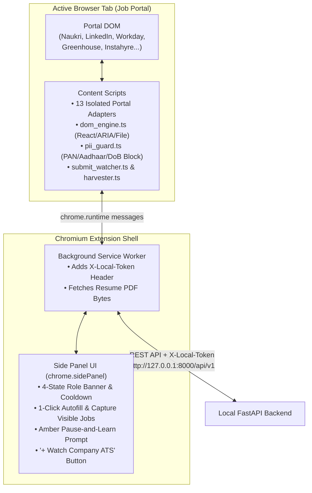

# 03. Local Web Dashboard & Chromium Extension Architecture

---

## 1. Local Web Dashboard (`React 19 + TypeScript + Vite + Tailwind + TanStack Query`)

Compiled to static assets and served directly from `http://127.0.0.1:8000` so daily usage requires launching only **one local process**.

### Five Core Pages & Interactive Drawers

| Page / Component | Key Capabilities & Data Displayed |
| :--- | :--- |
| **1. Job Queue (`JobQueuePage`)** | • **⚡ Fresh (`< 6h`) Priority Strip:** Pins `Tier S` & `Tier A` roles discovered/posted in the last 6 hours. • **Tier Tabs (`S / A / B / C`):** Driven by Combined Option 1 + Option 3 scoring. • **Quick Facets:** Filter by **Resume Track**, **`Missing <= 1 Skill`**, **`Apply Friction` (`Fast Apply` vs. `Enterprise ATS`)**, **City**, **Notice Compatibility**, and **Direct Employer Only**. • **Offline Boolean Search:** Sub-10ms SQLite FTS5 search (`FastAPI AND (Kafka OR Redis) NOT "night shift"`). • **Hidden Audit Tab:** Inspect Gate 1 filtered jobs with exact `hidden_reason` and 1-click unhide/rule tuning. |
| **2. Job Detail Drawer (`JobDetailDrawer`)** | • **4-State Status Banner & Winning Resume:** Displays selected PDF (`Resume_A_Backend.pdf`) with manual override dropdown. • **Option 1 Checklist:** Primary & Secondary stack match, Experience & Notice compatibility. • **Option 3 Bullet-by-Bullet Proof Table:** Every JD requirement line paired with its highest-matching real bullet from your resume (or `Gap`). • **Cross-Resume Bullet Alert:** Flags when an unmatched JD line is answered by a real bullet on another resume PDF. • **Side-by-Side JD Diff Viewer:** For yellow **Sibling Roles**, diffs the new boilerplate-stripped JD against the prior applied role. • **Company Cooldown Badge:** Warns when $\ge 2–3$ active apps exist at the company in the past 30 days. • **All Portal Links:** Consolidated apply links from `job_sources`. |
| **3. Applications Mini-CRM (`ApplicationsPage`)** | • **Stages:** `In Progress (Draft)` → `Applied` → `OA / Coding Test` → `Recruiter Screen` → `Tech Interviews` → `Offer` / `Rejected` / `No Response (30d)`. • **Unfinished / Abandoned Drafts Tab:** Lists roles where `autofill_started_at` exists without `submitted_at`. • **Recruiter Callback `<1s` Lookup:** Search by company/phone/notes to view the exact **Offline Snapshot** (immutable JD text, exact Resume PDF sent, and exact CTC/Notice answers submitted). |
| **4. Fact Vault & Rules (`FactVaultPage`)** | • Editor for all BGV-consistent India fields (CTC Fixed/Variable LPA/INR, Notice Period, LWD, Per-Skill Years, 10th/12th/UG/PG grades, City Aliases). • **Learned Q&A Rules Table:** Edit/delete screening answers learned from the Chromium Side Panel. • **Pre-Approved Templates & Dealbreakers:** Manage `{{variable}}` templates, negative title keywords, company blacklist, and 30-day cooldown limit. |
| **5. Resumes & Collectors (`ResumesPage` & `CollectorsPage`)** | • Upload PDFs, inspect extracted bullets & embeddings, trigger manual `All / ATS / JobSpy` syncs. • **Source Health Badges:** View `🟢 OK`, `🟡 Cooldown (with timer)`, `🔴 Error` per board/ATS. • **ATS Watchlist Manager** + **1-Click ZIP Backup Export/Import**. |

---

## 2. Chromium Manifest V3 Extension (`chrome.sidePanel`)

### Key Technical Mechanisms in the Extension

1. **Why `chrome.sidePanel`:** Sits beside the portal tab cleanly without colliding with Naukri's right-hand chatbot drawer or violating strict Workday Content Security Policies (CSP).
2. **3-Tier Deterministic Field Matching:**
   - **Tier 1 — 13 Isolated Portal Adapters:**
     - *Direct ATS:* `greenhouse.ts`, `lever.ts`, `ashby.ts`, `workday.ts` (handles multi-entry Work Experience/Education blocks), `smartrecruiters.ts`.
     - *India & Global Boards:* `naukri.ts` (standard Apply + Chatbot/Questionnaire drawer), `linkedin.ts` (Easy Apply multi-step modals), `indeed.ts`, `instahyre.ts`, `foundit.ts`, `hirist.ts`, `cutshort.ts`.
   - **Tier 2 — Semantic HTML Heuristic Fallback (`generic_heuristic.ts`):** Matches `<label for>`, `aria-label`, `placeholder`, `name`, and `autocomplete` attributes against Fact Vault keys and Learned Q&A aliases.
   - **Tier 3 — Amber Pause-and-Learn:** Unmatched fields are highlighted in **Amber** on the page and surfaced in the Side Panel ("Needs Your Verified Input"). Never guesses. Checking *"Save to Fact Vault"* sends `POST /vault/qa-rules` so the question fills automatically everywhere afterward.
3. **React / Angular Controlled State Bypass (`dom_engine.ts`):**
   - Resolves native property descriptors (`Object.getOwnPropertyDescriptor(HTMLInputElement.prototype, 'value').set`) and dispatches bubbling `input`, `change`, and `blur` events so React/Angular form state registers every filled value.
4. **Automatic Resume PDF Injection (`DataTransfer` API):**
   - Background worker fetches `GET /resumes/{winning_id}/file` as an `ArrayBuffer`, passes it to the content script, constructs a `File` inside `new DataTransfer()`, assigns `input.files = dt.files`, and fires `change`—attaching the right resume PDF (`Resume_A` vs `Resume_B`) automatically without opening the Windows file dialog.
5. **Custom Virtualized Dropdowns:**
   - Handles ARIA comboboxes and Workday/Greenhouse `
` menus via open click → deterministic option text match (including city aliases) → option click.
6. **Strict PII Guardrail (`pii_guard.ts`):**
   - Explicitly refuses to auto-fill government/sensitive fields matching **PAN, Aadhaar, Passport Number, or Full Date of Birth**, displaying a Side-Panel security warning instead.
7. **On-Demand DOM Harvester (`harvester.ts`) & Lifecycle Watcher (`submit_watcher.ts`):**
   - **Capture Visible Jobs:** User-triggered extraction from open search tabs on Instahyre, Hirist, Cutshort, Foundit, CareerBuilder, Naukri, and LinkedIn (`POST /extension/harvest`).
   - **4-Way Applied Tracking:** Fires `POST /extension/events` on autofill start (`autofill_started`), final submit click / confirmation banner (`submitted` + exact filled form answers), native portal `"Applied on..."` badge detection (`native_applied_badge`), and expired/closed notices (`job_expired`).
   - **Never Auto-Submits:** Stops before clicking the final Submit button so the user retains 100% sign-off control.
