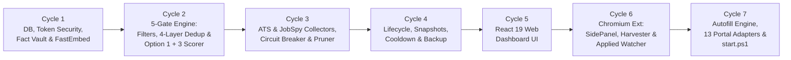

# 04. Incremental Implementation Roadmap (7 Code & Test Cycles)

Stage 3 executes in **7 incremental Code & Test Cycles**. Each cycle delivers working functionality verified by automated tests (`pytest` for backend, `Vitest` + `jsdom` for frontend/extension) before moving to the next cycle.

---

## 1. Cycle Dependency Flow

---

## 2. Detailed Cycle Breakdown

### Cycle 1: Foundation, Local Security, India Fact Vault & Multi-Resume Vectorizer
* **Code Scope:**
  - Initialize `backend/` (`FastAPI`, `Uvicorn`, `SQLite` WAL mode, `jobs_fts` FTS5 table + sync triggers, all 10 tables).
  - Implement `127.0.0.1` binding + `X-Local-Token` middleware + locked CORS.
  - Build India Fact Vault CRUD + PII blocklist (`PAN`, `Aadhaar`, `Passport`, `DoB`) + 500+ canonical skill/city taxonomy.
  - Build `pdfplumber` layout-aware bullet extractor + `fastembed` (`BAAI/bge-small-en-v1.5` ONNX Runtime) singleton embedder.
* **Automated Tests (`pytest`):**
  - Database WAL mode, FTS5 boolean query accuracy, and trigger sync verification.
  - Token rejection test (`401` when `X-Local-Token` is missing/wrong) and CORS policy checks.
  - Fact Vault validation + PII guardrail checks + deterministic PDF bullet extraction and 384-dim embedding generation on sample resumes.
* **Definition of Done:** Backend boots cleanly on `127.0.0.1:8000`, accepts sample resume PDF uploads, extracts bullets, and passes all Cycle 1 `pytest` assertions.

### Cycle 2: The 5-Gate Pipeline (Dealbreakers, 4-Layer Role Identity & Option 1+3 Scorer)
* **Code Scope:**
  - **Gate 1:** Negative title filter, company blacklist, experience regex parser, notice conflict detector, consultancy classifier, and `hidden_reason` audit storage.
  - **Gate 3 (Extraction & Boilerplate Stripping):** Strip HR intro/perks/EEO sections; extract all 10 structured fields (Must-Have vs. Bonus skills, LPA salary, work mode, locality, notice constraints, req ID, friction tag, employer type).
  - **Gate 2:** 4-Layer Role Identity Fingerprint (`Req ID` isolation, `role_subtag` generator, SimHash + `88%` boilerplate-stripped vector similarity, Sibling Role linking, Side-by-Side JD Diff engine, `repost_count`).
  - **Gate 4:** Combined **Option 1 (`Tier S/A/B/C`) + Option 3 (Semantic Bullet Alignment)** evaluator, Best-Resume router, Bullet Proof Table builder, and Cross-Resume Bullet Alert detector.
* **Automated Tests (`pytest` with realistic Indian JD fixtures):**
  - *Sibling Role Test:* `"Razorpay SDE II (Payments Go/Kafka)"` vs. `"Razorpay SDE II (Frontend React)"` stay separate with distinct sub-tags and highlighted JD diff; identical Naukri + LinkedIn postings merge into `job_sources`.
  - *Boilerplate Isolation Test:* Two different roles sharing an identical 400-word company footer still evaluate below the `88%` merge threshold.
  - *Multi-Resume Routing Test:* Backend JD selects Backend PDF; Full-Stack JD selects Full-Stack PDF; Cross-Resume Bullet Alert triggers accurately with zero fabricated bullets.
* **Definition of Done:** All pipeline gates process fixture batches deterministically with 100% passing `pytest` coverage.

### Cycle 3: Job Collectors (Tier 3 ATS + Tier 1 JobSpy), Circuit Breaker & Auto-Pruner
* **Code Scope:**
  - Fault-isolated collector runner + `collector_runs` telemetry + automatic `429/403` circuit breaker (`6–12h` cooldown).
  - Direct ATS JSON connectors (`ats_greenhouse.py`, `ats_lever.py`, `ats_ashby.py`, `ats_smartrecruiters.py`, `ats_workday.py` enforcing `limit <= 20`, 2,000-job facet splitting, and pagination loop stop).
  - Pre-seeded `watchlist_seed.json` (60+ India Tech Unicorns & GCCs) + India location normalizer.
  - `python-jobspy` connector with credential isolation, 4–8s jitter, `hours_old=24`, and already-seen URL skip.
  - ATS vanished-job pruner (`Closed`) + `APScheduler` periodic jobs.
* **Automated Tests (`pytest` + controlled smoke test):**
  - Mocked HTTP unit tests for all 5 ATS connectors (including Workday 20-limit, loop prevention, and India filtering).
  - Circuit breaker test (`429` halts connector immediately and sets `cooldown_until` without aborting sibling connectors).
  - Live smoke test fetching 1–2 public Greenhouse/Lever boards into local SQLite.
* **Definition of Done:** Collectors populate real India tech jobs into SQLite safely and expose Source Health telemetry.

### Cycle 4: Application Lifecycle, Offline Snapshots, Cooldowns, Templates & Backup
* **Code Scope:**
  - `/extension/check-page` 4-State banner resolver (`NEW ROLE`, `NEW SIBLING ROLE`, `STARTED BUT NOT SUBMITTED`, `ALREADY APPLIED`).
  - Application Mini-CRM endpoints (`draft`, `applied`, `oa`, `screen`, `interview`, `offer`, `rejected`) + `submitted_at` vs. `autofill_started_at` separation.
  - Immutable Offline Snapshot writer (`jd_snapshot_text`, `resume_filename_snapshot`, `submitted_answers_json`).
  - 30-day Company Cooldown checker, deterministic `{{variable}}` Cover Template renderer, and 1-click ZIP Backup Export/Import.
* **Automated Tests (`pytest`):**
  - Full lifecycle tests: `Discovered` → `Autofill Started` → `Submitted` → `Repost Red Banner` → `Sibling Diff` → `30-Day Cooldown Warning` → `ZIP Export/Restore` round-trip.
* **Definition of Done:** Backend REST API (`/api/v1`) is feature-complete and 100% verified.

### Cycle 5: Local Web Dashboard (`React 19 + Vite + Tailwind`)
* **Code Scope:**
  - Build all 5 views (`JobQueuePage`, `ApplicationsPage`, `FactVaultPage`, `ResumesPage`, `CollectorsPage`) and `JobDetailDrawer` (Option 1+3 Proof Table, Cross-Resume Alert, Side-by-Side JD Diff Viewer, Cooldown Badge, Hidden Audit Tab).
  - Wire Vite production build directly to FastAPI static serving (`/`).
* **Automated Tests (`Vitest`):**
  - Component tests for tier filtering, FTS5 search binding, JD Diff rendering, Fact Vault form validation, and Offline Snapshot lookup against mocked API responses + live local UI verification against `127.0.0.1:8000`.
* **Definition of Done:** Complete local web dashboard works end-to-end against the real FastAPI backend.

### Cycle 6: Chromium Extension Core (`chrome.sidePanel`, DOM Harvester & Applied Watcher)
* **Code Scope:**
  - Manifest V3 scaffold (`sidePanel`, `activeTab`, `scripting`, `storage`, `127.0.0.1` permission).
  - Background Service Worker (`X-Local-Token` bridge + PDF `ArrayBuffer` proxy).
  - Side Panel UI (4-State Banner, Winning Resume badge, Cooldown alert, **"+ Watch Company ATS"** button, **"Capture Visible Jobs"** button).
  - `harvester.ts` for on-demand DOM extraction on Instahyre, Hirist, Cutshort, Foundit, CareerBuilder, Naukri, and LinkedIn + `submit_watcher.ts` (Submit click, Confirmation screen, Native `"Applied"` badge sync, `"Expired"` detector).
* **Automated Tests (`Vitest` + `jsdom`):**
  - DOM snapshot tests verifying accurate job card parsing and Applied/Expired badge detection across saved portal HTML fragments + manual unpacked load check in Chromium.
* **Definition of Done:** Extension loads cleanly in Chromium, detects page status, harvests tier-2 portal listings, and syncs applied events.

### Cycle 7: Deterministic Autofill Engine, 13 Portal Adapters & Windows Launcher
* **Code Scope:**
  - `dom_engine.ts` (React/Angular prototype setters, bubbling events, `DataTransfer` PDF injection, ARIA dropdowns) + `pii_guard.ts` + Amber Pause-and-Learn Side Panel flow.
  - 13 isolated portal adapters (`greenhouse`, `lever`, `ashby`, `smartrecruiters`, `workday`, `naukri` + Chatbot drawer, `linkedin` Easy Apply, `indeed`, `instahyre`, `foundit`, `hirist`, `cutshort`, `generic_heuristic`).
  - `start.ps1` 1-click startup script launching Uvicorn and opening `http://127.0.0.1:8000`.
* **Automated Tests (`Vitest` + `jsdom` + local mock-form test harness):**
  - Automated tests on synthetic React forms (Greenhouse, Workday multi-entry, Naukri Chatbot, LinkedIn Easy Apply) asserting: React state commits, PDF `input.files` populated via `DataTransfer`, unknown questions highlight Amber & save to `/vault/qa-rules`, PAN/Aadhaar/DoB fields stay blocked, and Submit is never auto-clicked.
* **Definition of Done:** Full system runs via `start.ps1` with all backend and extension test suites passing.

---

## 3. Technical Risk & Mitigation Matrix

| Risk | Concrete Mitigation Built into Plan |
| :--- | :--- |
| **Windows `onnxruntime` DLL load error (`fastembed`)** | Cycle 1 includes an environment verification check for the Microsoft Visual C++ Redistributable before installing/initializing `fastembed`. |
| **Untrusted browser tabs probing `localhost:8000`** | Mandatory `127.0.0.1` loopback bind, random `X-Local-Token` header, and strict CORS restricted to local UI + extension origin. |
| **Portal DOM layout updates breaking autofill** | Each portal lives in an isolated adapter file (`extension/src/content/adapters/`) backed by `generic_heuristic.ts` and Amber Pause-and-Learn, preventing global breakage. |
| **Workday CXS undocumented API limits** | Hardcoded guards in `ats_workday.py`: `limit <= 20`, automatic India facet partitioning when `total > 2000`, and strict stop at `offset >= total`. |
| **False duplicate merging of sibling roles** | Boilerplate stripped *before* similarity scoring + Req ID isolation + `88%` threshold + Side-by-Side JD Diff Viewer. |
