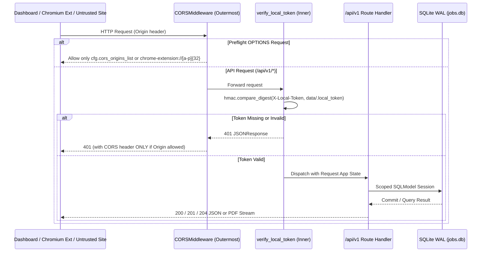

# 01. Security, Database & FTS5 Internals

---

## 1. Request Lifecycle, Loopback Auth & CORS Ordering

FastAPI/Starlette applies middlewares in **reverse registration order** (the last middleware added wraps the outermost layer). In [main.py](file:///f:/Projects/JobAutomation/backend/app/main.py), `CORSMiddleware` is deliberately registered **after** `verify_local_token` so preflight `OPTIONS` requests and `401` error responses still carry valid CORS headers for permitted origins while untrusted sites receive none.

### Key Security Rules
- **Token Persistence:** `get_or_create_local_token(data_dir)` reads `data/.local_token` or creates a 256-bit `secrets.token_urlsafe(32)` secret on first run.
- **Exempt Routes:** Only `/health` and `OPTIONS` preflight requests skip token validation; every `/api/v1/*` route enforces `X-Local-Token`.
- **PII Guardrail ([pii_guard.py](file:///f:/Projects/JobAutomation/backend/app/vault/pii_guard.py)):** `POST /api/v1/vault/qa-rules` inspects both question labels and answer strings, returning `HTTP 422` if a question asks for PAN, Aadhaar, Passport, Date of Birth, Bank/IFSC, or UAN/PF—or if an answer contains a PAN (`[A-Z]{5}[0-9]{4}[A-Z]`) or 12-digit Aadhaar regex match.

---

## 2. SQLite WAL Configuration, Foreign-Key Cascades & FTS5

### Connection Pragmas ([database.py](file:///f:/Projects/JobAutomation/backend/app/db/database.py))
Every SQLite connection runs a `connect` hook setting:
- `PRAGMA journal_mode=WAL;` — Allows concurrent reads (Dashboard/Extension) while background writers commit.
- `PRAGMA foreign_keys=ON;` — Enforces relational deletes at the SQLite engine level.
- `PRAGMA synchronous=NORMAL;` — Fast commits safe under WAL mode.
- `PRAGMA busy_timeout=5000;` — Prevents transient `database is locked` errors under simultaneous API hits.

### Cascade & Data Preservation Matrix

| Parent Table | Child Table | `ondelete` Policy | Why |
| :--- | :--- | :--- | :--- |
| `resumes` | `resume_bullets` | `CASCADE` | Deleting/reparsing a resume removes stale vectors; `DELETE /resumes/{id}` also checks remaining DB refs to the same `pdf_path` before unlinking disk PDFs. |
| `jobs` | `job_sources` | `CASCADE` | Removing a job cleans up its portal links. |
| `jobs` & `resumes` | `job_resume_scores` | `CASCADE` | Scores are derived artifacts and always safe to drop/recompute. |
| `jobs` & `resumes` | `applications` | **`SET NULL`** | **Critical protection:** Immutable `jd_snapshot_text`, `resume_filename_snapshot`, and `submitted_answers_json` survive even if a job or resume record is later deleted. |

### External-Content FTS5 (`jobs_fts`) Sync Mechanics
`jobs_fts` mirrors 5 columns (`title`, `company_name`, `role_subtag`, `boilerplate_stripped_text`, `normalized_city`) using `content='jobs', content_rowid='id'` so text isn't duplicated redundantly across normal columns and FTS storage:
- Three triggers (`jobs_fts_ai`, `jobs_fts_ad`, `jobs_fts_au`) automatically keep `jobs_fts` synchronized on every SQLAlchemy `INSERT`, `DELETE`, and `UPDATE`.
- `search_jobs_fts(session, query, limit)` runs `SELECT rowid FROM jobs_fts WHERE jobs_fts MATCH :query ORDER BY bm25(jobs_fts) LIMIT :limit`, supporting offline boolean queries (`FastAPI AND (Kafka OR Redis) NOT "night shift"`).

---

## 3. Local Test Isolation Mechanics ([conftest.py](file:///f:/Projects/JobAutomation/backend/tests/conftest.py))

- **Preventing Real DB Pollution:** `conftest.py` sets `JOB_AUTOMATION_SKIP_DEFAULT_APP=1` before importing `app.main`, skipping module-level `create_app()` so tests never touch `f:\Projects\JobAutomation\data\jobs.db`.
- **Two Embedders in Tests:**
  - `DeterministicTestEmbedder`: Fast token-hash 384-dim vectors for DB/CRUD/Settings tests without loading ONNX Runtime.
  - `real_fastembed_service` (`scope="session"`): Loads the real cached `BAAI/bge-small-en-v1.5` ONNX model once per `pytest` session from `.fastembed_cache/`.
- **Windows Sandbox Note:** Python 3.12's `asyncio` loopback `socketpair` deadlocks inside the network-isolated Windows sandbox; therefore `TestClient` suites execute directly in the user's PowerShell terminal while pure-Python tests (`py_compile`, `test_config_and_data.py`, `-k test_gate3`) run cleanly inside the sandbox.

