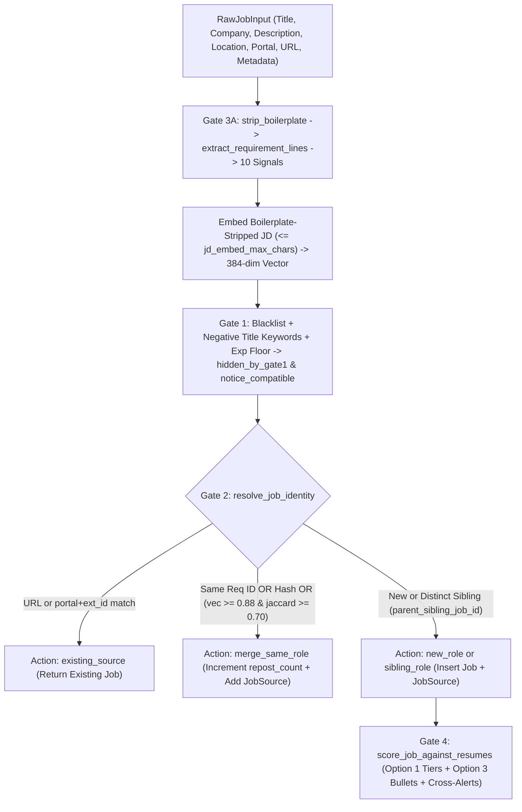

# 02. 5-Gate Pipeline Mechanisms & Internal Flows

---

## 1. End-to-End Ingestion Sequence (`orchestrator.ingest_job`)

---

## 2. Gate 3A — Boilerplate Stripping & 10-Field Extraction ([gate3_extractor.py](file:///f:/Projects/JobAutomation/backend/app/pipeline/gate3_extractor.py))

1. **HTML-to-Text (`html_to_clean_text`):** Converts `<li>` to `"• "` bullets, `
/<div/ /<h*>` to newlines, unescapes HTML entities, and collapses intra-line whitespace.
2. **Boilerplate Stripping (`strip_boilerplate`):**
   - Evaluates heading lines (`len <= 85`): `_KEEP_HEADER_RE` (`About the Role`, `Responsibilities`, `Requirements`, `Skills`, `Nice to Have`) is checked **before** `_BOILERPLATE_HEADER_RE` (`About Us`, `About <Company>`, `Benefits & Perks`, `Equal Opportunity Employer`) so `"About the Role"` stays while `"About Razorpay"` is dropped.
   - Removes EEO boilerplate sentences anywhere via `_EEO_SENTENCE_RE`, with a fallback ensuring unstructured JDs aren't wiped empty.
3. **Requirement Segmentation (`extract_requirement_lines`):** Strips bullet glyphs, discards short headers (`< 40 chars` ending with `:` or matching headings), splits prose paragraphs `> 220` chars on sentence boundaries, keeps unique lines sized `15..300` chars.
4. **Skill Matching Safety ([taxonomy.py](file:///f:/Projects/JobAutomation/backend/app/vault/taxonomy.py)):**
   - Uses lookarounds `(?<![A-Za-z0-9_])...(?![A-Za-z0-9_])` instead of `\b` so punctuation tokens (`C++`, `C#`, `.NET`, `Node.js`, `CI/CD`) match cleanly.
   - Enforces `_STRICT_CASED_PATTERNS` so lowercase English `"go"` (`"willing to go"`) or `"c"` (`"cloud"`) never trigger `Go`, `C`, or `R`.
   - Splits `primary_skills` (Title + Mandatory lines) from `secondary_skills` (`Nice to Have` / `Preferred` / `Bonus` blocks and inline prefixes).
5. **Workday & ATS Req ID Extraction (`_extract_req_id`):**
   - Extracts URL params (`gh_jid`, `req_id`, `requisition_id`, `jobId`), text labels (`Req ID: ...`), and Workday `_JR` suffixes using `(?<![A-Za-z0-9])(JR[-_]?\d{3,})(?![A-Za-z0-9])` because regex `\b` fails around underscores (`FS_JR8801`).
6. **Domain Sub-Tag Scoring (`_build_role_subtag`):**
   - Scores every domain in `pipeline_rules.json` via `text_hits * text_weight + skill_hits` (`text_weight = 3` for specific product/team domains like `Payments`, `Data Platform`, `AI / ML`, `Search & Ads`, `Security`, `Mobile`; `2` for `Frontend`, `Platform / Infra`, `Backend`), avoiding false wins from tuple ordering.

---

## 3. Gate 1 — Hard Dealbreakers & Notice Math ([gate1_filters.py](file:///f:/Projects/JobAutomation/backend/app/pipeline/gate1_filters.py))

* **Effective Candidate Notice Days:**
  1. If `serving_notice` and `last_working_day` is set: `max(0, (last_working_day - today).days)`.
  2. Else if `notice_negotiable` and `min_negotiable_days` is set: `min(notice_period_days, min_negotiable_days)`.
  3. Else: `notice_period_days`.
* **Hidden Audit Trail:** Rejects company blacklist matches, negative title keywords, and extreme experience gaps (`exp_min_years > total_exp_years + cfg.gate1_exp_buffer_years`) by setting `hidden_by_gate1 = True` and recording exact `hidden_reason`. Records are **never deleted** and can be unhidden via `PATCH /api/v1/jobs/{id}/status`.

---

## 4. Gate 2 — 4-Layer Role Identity & JD Diff ([gate2_identity.py](file:///f:/Projects/JobAutomation/backend/app/pipeline/gate2_identity.py))

1. **Exact Source Check:** Matches `JobSource.job_url` or `(portal_name, external_job_id)` first (`existing_source`).
2. **Layer 1 (Req ID):** Same `(company_slug, req_id)` merges (`merge_same_role`); distinct non-empty `req_id`s are **never** merged even if title and city match (`sibling_role`).
3. **Layer 3 (Content Similarity):** Among jobs sharing `(company_slug, normalized_title, normalized_city)`, merges if `description_hash` matches **OR** (`cosine_similarity >= cfg.dedup_similarity_threshold` **AND** `primary_stack_jaccard >= cfg.dedup_stack_overlap_threshold`). Otherwise assigns `parent_sibling_job_id` as a separate `sibling_role`.
4. **SimHash Storage:** Computes 64-bit token SimHash via `blake2b(digest_size=8)` and shifts `>= 2^63` into signed int64 so SQLite `INTEGER` stores it without overflow.
5. **JD Diff (`compute_jd_diff`):** Runs `difflib.SequenceMatcher` over extracted requirement lines of both jobs' `boilerplate_stripped_text` plus primary skill set differences.

---

## 5. Gate 4 — Combined Option 1 + Option 3 Scorer ([gate4_scorer.py](file:///f:/Projects/JobAutomation/backend/app/pipeline/gate4_scorer.py))

1. **Vector Similarity Matrix (Option 3):**
   - Encodes JD requirement lines once: `req_vectors` shape `(M, 384)`.
   - Multiplies against each active resume's pre-stored L2-normalized `ResumeBullet` vectors: `sim_matrix = req_vectors @ bullet_matrix.T`.
   - Line $i$ is `MATCHED` if $\max_j(\text{sim}_{i,j}) \ge \text{cfg.semantic\_threshold}$ (default `0.72`), recording the **exact verbatim `bullet_text`** (0% hallucination).
2. **Hard Checklist & Tier Rules (Option 1 + Option 3):**
   - **Hard `Tier C` Guard:** Triggers if JD requires `CORE_LANGUAGES` and candidate resume shares **zero** core languages (`len(jd_core_langs & resume_skills) == 0`), OR `exp_fit == "under"`, OR `coverage_pct < cfg.tier_b_coverage_pct`, OR `primary_match_ratio < cfg.tier_c_min_primary_ratio`.
   - **`Tier S`:** `archetype_ok` AND `missing_primary == 0` AND `exp_fit == "exact"` AND `logistics_ok` AND `coverage_pct >= cfg.tier_s_coverage_pct` (`80%`).
   - **`Tier A`:** (`missing_primary == 0` OR `primary_match_ratio >= 0.75`) AND `exp_fit in {"exact", "stretch"}` AND `missing_secondary <= 2` AND `coverage_pct >= cfg.tier_a_coverage_pct` (`60%`).
   - **`Tier B`:** (`missing_primary <= 1` OR `primary_match_ratio >= 0.50`) AND `exp_fit in {"exact", "stretch"}` AND `coverage_pct >= cfg.tier_b_coverage_pct` (`40%`).
3. **Winner Selection & Cross-Resume Alerts:**
   - Ranks resumes by `(tier_rank, coverage_pct, -len(missing_primary), len(matched_primary), -resume_id)`.
   - For every `GAP` line on the winning resume, scans all other active resumes for a verbatim bullet with `sim >= threshold` and attaches it to `cross_resume_alerts_json`.

---

## 6. Resume PDF Parsing & File Hygiene ([parser.py](file:///f:/Projects/JobAutomation/backend/app/resumes/parser.py), [api/resumes.py](file:///f:/Projects/JobAutomation/backend/app/api/resumes.py))

- Uses `pdfplumber` page-by-page (fallback `pypdf`), detects standard headings (`summary`, `experience`, `projects`, `skills`, `education`, `certifications`), joins wrapped bullet lines unless a job/date header (`_looks_like_job_header`) interrupts, and extracts canonical skills.
- Stores PDFs under `data/resumes/<sha256[:12]>_<sanitized_filename>.pdf`; `DELETE /resumes/{id}` only removes the disk file when zero remaining DB rows reference that `pdf_path`.

