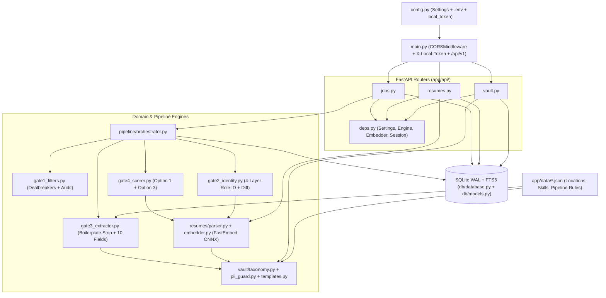

# Technical Reference — Architecture, Mechanisms & Debugging

Living engineering guide documenting **exact internal mechanisms, data flows, mathematical thresholds, debugging procedures, and future extension hooks** for the implemented codebase.

---

## Runtime Module Dependency Map

---

## Reference Documents

| Document | Engineering Topics Covered |
| :--- | :--- |
| [01_Security_Database_and_FTS5_Internals.md](file:///f:/Projects/JobAutomation/Documentation/Technical%20Reference/01_Security_Database_and_FTS5_Internals.md) | Middleware execution order, `X-Local-Token` authentication, CORS policy, SQLite WAL pragmas, cascade rules (`SET NULL` on `applications`), FTS5 triggers, and test isolation mechanics. |
| [02_5Gate_Pipeline_Mechanisms_and_Flows.md](file:///f:/Projects/JobAutomation/Documentation/Technical%20Reference/02_5Gate_Pipeline_Mechanisms_and_Flows.md) | Exact execution order inside `ingest_job()`, boilerplate stripping priority rules, regex/boundary skill matching, Workday `_JR` extraction, Gate 1 notice math, Gate 2 SimHash + `0.88` identity logic, Gate 4 Option 1+3 formulas, and PDF parsing. |
| [03_Configuration_Debugging_and_Extension_Guide.md](file:///f:/Projects/JobAutomation/Documentation/Technical%20Reference/03_Configuration_Debugging_and_Extension_Guide.md) | Zero-code modification guide for JSON files & all 17 `.env` thresholds, troubleshooting playbook (`401`, `422`, FTS5, ONNX, hidden jobs), and exact integration seams for Cycles 3–7. |
| [04_Job_Collectors_ATS_Feeds_and_Circuit_Breakers.md](file:///f:/Projects/JobAutomation/Documentation/Technical%20Reference/04_Job_Collectors_ATS_Feeds_and_Circuit_Breakers.md) | ATS JSON connectors (Greenhouse, Lever, Ashby, SmartRecruiters, Workday limit <= 20), circuit-breaker cooldowns on 429/403, closed-job pruner, JobSpy jitter, and background scheduler. |
| [05_Application_CRM_Snapshots_Extension_Bridge_and_Backup.md](file:///f:/Projects/JobAutomation/Documentation/Technical%20Reference/05_Application_CRM_Snapshots_Extension_Bridge_and_Backup.md) | Draft vs. Submitted CRM stages, immutable offline snapshots (`ON DELETE SET NULL`), 30-day rolling cooldowns, Extension 4-State Banner resolver, and WAL-safe ZIP backup/restore mechanics. |

