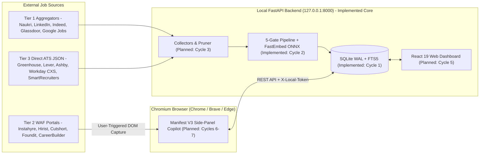

# Job Search & Apply Automation (India-First • Zero-Hallucination • $0 Local-First)

A free-forever (`$0`), local-first job discovery, multi-resume scoring, and Chromium Side-Panel assisted application platform built primarily for the **Indian tech job market**, while supporting global job boards and direct company Applicant Tracking Systems (ATS).

---

## Core Design Principles

- **$0 Forever & 100% Local-First:** Runs locally on `127.0.0.1:8000` with SQLite (`WAL + FTS5`), local CPU vector embeddings (`fastembed`), and an unpacked Chromium extension—zero cloud bills, zero paid scraper APIs, and zero LLM subscriptions.
- **India-First Coverage:** Engineered for **Naukri, LinkedIn India, Indeed India, Glassdoor India, Google Jobs India, Instahyre, Hirist, Cutshort, Wellfound, Foundit (Monster), CareerBuilder**, plus direct ATS JSON feeds (**Greenhouse, Lever, Ashby, SmartRecruiters, Workday CXS**).
- **Zero Hallucinations & Zero Fabricated Info:**
  - **Autofill:** 100% deterministic from your **Verified Fact Vault** (LPA/INR CTC, Notice Period, LWD, Per-Skill Experience Years, 10th/12th/UG/PG scores, Indian city aliases), backed by an **Amber Pause-and-Learn** flow for unknown questions and hard **PII Guardrails** blocking PAN, Aadhaar, Passport, DoB, Bank/IFSC, and UAN/PF.
  - **Multi-Resume Scoring & Routing:** Combines **Option 1 (`Tier S / A / B / C` Hard Checklist)** with **Option 3 (Local CPU Semantic Bullet-to-Bullet Alignment via `BAAI/bge-small-en-v1.5`)**—ranking jobs and routing your PDF tracks with verbatim resume bullet proof and Cross-Resume Bullet Alerts (zero generative LLM text).
- **Safety & Anti-Ban Architecture:** Complete credential isolation (background collectors never touch personal session cookies), polite `4–8s` jitter + automatic `429/403` circuit breaker, on-demand DOM harvesting on strict-WAF portals, and human-in-the-loop sign-off (never auto-submits or bypasses CAPTCHAs/2FA).
- **Localhost Security:** Loopback-only `127.0.0.1` binding, auto-generated `X-Local-Token` header (`data/.local_token`), and locked CORS.

---

## System Architecture



---

## Tech Stack

| Layer | Technology | Status |
| :--- | :--- | :--- |
| **Backend & Security** | Python 3.12, FastAPI, Uvicorn, `X-Local-Token` + CORS | **Implemented** |
| **Database & Search** | SQLite (`WAL` + `PRAGMA foreign_keys=ON`), SQLModel/SQLAlchemy, FTS5 Triggers | **Implemented** |
| **Local Semantic Engine** | `fastembed` (`BAAI/bge-small-en-v1.5` 384-dim via ONNX Runtime, ~90 MB CPU) | **Implemented** |
| **Resume PDF Parsing** | `pdfplumber` + `pypdf` deterministic section & bullet extraction | **Implemented** |
| **External Rules & Config** | `pydantic-settings` (`.env`) + JSON rules (`backend/app/data/*.json`) | **Implemented** |
| **Job Collectors & Scheduler** | `python-jobspy`, async `httpx` ATS connectors, `APScheduler` | **Planned (Cycle 3)** |
| **Web Dashboard** | React 19, TypeScript, Vite, Tailwind CSS, TanStack Query | **Planned (Cycle 5)** |
| **Browser Copilot** | Manifest V3 Chromium Extension (`chrome.sidePanel`), 13 portal adapters | **Planned (Cycles 6–7)** |

---

## Implementation Status (Stage 3 Roadmap)

| Phase / Cycle | Scope | Status |
| :--- | :--- | :--- |
| **Phase 0** | Repo setup (`.gitignore`, `.gitattributes`, `.editorconfig`, `.env.example`), Stage 1 Research & Stage 2 Planning docs | **Implemented** |
| **Cycle 1** | FastAPI loopback security (`X-Local-Token`, CORS), SQLite WAL + 10 tables + FTS5, India Fact Vault, PII Guardrails, 500+ skill/city taxonomy, Cover Templates, PDF Parser & `FastEmbed` ONNX vectorizer | **Implemented** *(9/9 tests passed)* |
| **Cycle 2** | 5-Gate Pipeline: Gate 3 Boilerplate Stripper + 10-Field Extractor, Gate 1 Dealbreakers + Hidden Audit, Gate 2 4-Layer Sibling Role Identity + Side-by-Side JD Diff, Gate 4 Option 1 (`Tier S/A/B/C`) + Option 3 Semantic Bullet Proof + Cross-Resume Alerts, `/api/v1/jobs` API | **Implemented** *(All Cycle 2 logic & bug fixes complete)* |
| **Cycle 2.5** | De-Hardcoding Refactor: 17 pipeline thresholds + CORS moved to `Settings`/`.env`; skills, cities & domain rules externalized to `backend/app/data/*.json` | **Implemented** *(16-test suite ready)* |
| **Cycle 3 / 3.5** | Direct ATS JSON Collectors (5 ATS + Workday India fallback + incremental detail fetch), `python-jobspy` (Naukri default), 68-company India Watchlist seed + `POST /verify`, `429/403` Circuit Breaker, `404` `invalid_config`, Closed-Job Pruner, `asyncio.Semaphore` concurrency, `GET /progress`, composite SQLite indexes, stale-run recovery, resumable checkpoints, rotating `data/app.log`, FastAPI `lifespan` Scheduler | **Implemented** *(17 collector tests; 33 total)* |
| **Cycle 4** | Application Mini-CRM, Draft vs. Submitted tracking, Immutable Offline Snapshots, 30-Day Company Cooldowns, `/api/v1/extension/*` Bridge, ZIP Backup/Restore | **Planned** |
| **Cycle 5** | Local React 19 + Vite + Tailwind Web Dashboard (`frontend/`) | **Planned** |
| **Cycle 6** | Chromium Manifest V3 Extension (`chrome.sidePanel`), On-Demand DOM Harvester, Applied/Expired Watcher (`extension/`) | **Planned** |
| **Cycle 7** | React/Angular DOM Autofill Engine, `DataTransfer` PDF Auto-Attach, Amber Pause-and-Learn UI, 13 Portal Adapters, `start.ps1` | **Planned** |

---

## Currently Implemented API Endpoints (`http://127.0.0.1:8000`)

All `/api/v1/*` routes require `X-Local-Token` (auto-generated in `data/.local_token`).

| Domain | Endpoints | Purpose |
| :--- | :--- | :--- |
| **System** | `GET /health` | Loopback server health check (unauthenticated) |
| **Vault & Rules** | `GET / PUT /api/v1/vault`<br>`GET / POST / DELETE /api/v1/vault/qa-rules`<br>`POST /api/v1/vault/taxonomy/normalize`<br>`POST /api/v1/vault/templates/render` | Manage BGV-consistent India Fact Vault, PII-guarded Q&A rules, skill/city normalization, and deterministic cover templates |
| **Multi-Resume** | `GET / POST /api/v1/resumes`<br>`GET / PATCH / DELETE /api/v1/resumes/{id}`<br>`GET /api/v1/resumes/{id}/file`<br>`POST /api/v1/resumes/{id}/reparse` | Upload PDF tracks, inspect verbatim bullets + 384-dim embeddings, stream raw PDFs, update track metadata, or re-vectorize |
| **5-Gate Jobs** | `POST /api/v1/jobs/ingest`<br>`GET /api/v1/jobs`<br>`GET /api/v1/jobs/{id}`<br>`GET /api/v1/jobs/{id}/diff/{sibling_id}`<br>`PATCH /api/v1/jobs/{id}/status`<br>`POST /api/v1/jobs/rescore` | Run full 5-Gate ingestion, query by Tier / Resume Track / `fresh_6h` / `missing_max` / `friction` / `only_hidden` / FTS5 boolean search, diff sibling roles, or re-score |
| **Watchlist** | `GET / POST /api/v1/watchlist`<br>`PATCH / DELETE /api/v1/watchlist/{slug}`<br>`POST /api/v1/watchlist/seed` | Manage watched companies, configure ATS feeds (Greenhouse, Lever, Ashby, SmartRecruiters, Workday), and sync 68 pre-seeded Indian tech companies |
| **Collectors & Health** | `POST /api/v1/collectors/run`<br>`GET /api/v1/collectors/health`<br>`GET /api/v1/collectors/runs` | Manually trigger collection across all/ATS/JobSpy/slug, inspect circuit-breaker cooldown countdowns and source health badges, and view execution telemetry |

---

## Quick Start & Customization (Windows PowerShell)

**Prerequisites:** Python `3.12+`, Node.js `20+` (for upcoming Cycles 5–7), Chromium browser (Chrome / Brave / Edge).

```powershell
# 1. Create and activate virtual environment & install backend dependencies
python -m venv .venv
.\.venv\Scripts\pip.exe install -r backend\requirements.txt

# 2. Optional: create .env from template to tune any of the 17 pipeline thresholds
Copy-Item .env.example .env

# 3. Run the full automated backend test suite (33 tests; first run caches ~90 MB ONNX model)
.\.venv\Scripts\pytest.exe backend\tests -v

# 4. Start the local FastAPI backend (Swagger UI available at http://127.0.0.1:8000/docs)
.\.venv\Scripts\uvicorn.exe app.main:app --app-dir backend --host 127.0.0.1 --port 8000
```

- **Customize Skills, Cities & Rules Without Code Edits:** Update [backend/app/data/skills_taxonomy.json](backend/app/data/skills_taxonomy.json), [backend/app/data/india_locations.json](backend/app/data/india_locations.json), or [backend/app/data/pipeline_rules.json](backend/app/data/pipeline_rules.json), and tune thresholds in `.env` (see [.env.example](.env.example)).

---

## Repository Layout

```text
JobAutomation/
├── Documentation/
│   ├── Innitial Research/         # Stage 1: Platform, Multi-Resume, Tracking & Autofill Research
│   ├── Planning/                  # Stage 2: DB Schema, API Contracts, Safety & 7 Cycles Plan
│   ├── Implementation Progress/   # Cycle-wise log & file-wise inventory of completed code
│   └── Technical Reference/       # Internal flows, mechanisms, debugging & extension guides
├── backend/
│   ├── app/
│   │   ├── api/                   # Implemented: deps, vault, resumes, jobs
│   │   ├── data/                  # Implemented: india_locations.json, skills_taxonomy.json, pipeline_rules.json
│   │   ├── db/                    # Implemented: SQLModel 10-table schema + SQLite WAL/FTS5 triggers
│   │   ├── pipeline/              # Implemented: gate1_filters, gate2_identity, gate3_extractor, gate4_scorer, orchestrator
│   │   ├── resumes/               # Implemented: PDF parser + FastEmbed ONNX embedder
│   │   ├── schemas/               # Implemented: Pydantic v2 API contracts
│   │   ├── vault/                 # Implemented: pii_guard, taxonomy, templates
│   │   ├── config.py              # Implemented: Settings (.env) + loopback token generator
│   │   └── main.py                # Implemented: FastAPI app, X-Local-Token middleware & CORS
│   ├── tests/                     # 5 Pytest modules (16 tests across Cycles 1, 2 & Config/Data)
│   ├── pytest.ini
│   └── requirements.txt
├── frontend/                      # Planned (Cycle 5): React 19 + Vite + Tailwind Local Dashboard
├── extension/                     # Planned (Cycles 6-7): Manifest V3 Chromium Side-Panel Copilot
├── data/                          # Gitignored local SQLite DB, Resume PDFs, .local_token & Backups
├── .env.example
├── .gitattributes
├── .editorconfig
├── .gitignore
└── LICENSE                        # GNU Affero General Public License v3.0
```

---

## Documentation Hub

- **Stage 1 — Initial Research:** [Documentation/Innitial Research/README.md](Documentation/Innitial%20Research/README.md)
- **Stage 2 — Planning & Roadmap:** [Documentation/Planning/README.md](Documentation/Planning/README.md)
- **Stage 3 — Cycle & File Progress:** [Documentation/Implementation Progress/README.md](Documentation/Implementation%20Progress/README.md)
- **Engineering Reference & Debugging:** [Documentation/Technical Reference/README.md](Documentation/Technical%20Reference/README.md)

## License

Licensed under the [GNU Affero General Public License v3.0](LICENSE).
